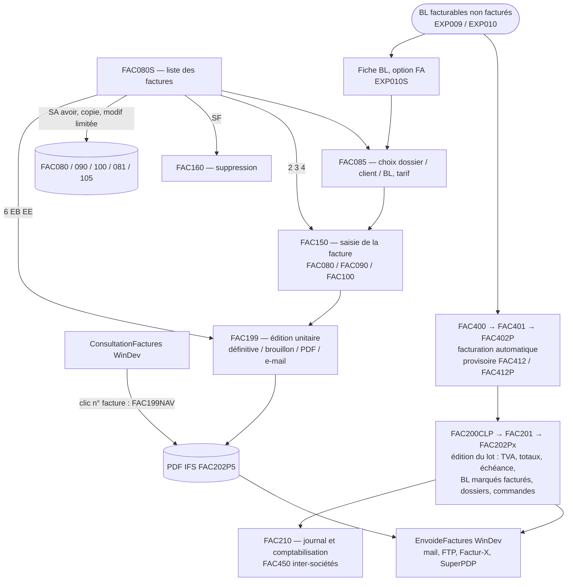

# Facturation : vue d'ensemble avant de démarrer (31/10/2026)

Exploration de la chaîne de facturation de NetPrint demandée par David pendant l'arrêt de l'AS400 de test : programmes RPG
FAC08*, FAC150, FAC199, FAC201, FAC4*, projets WinDev ConsultationFactures, VisuFacture et EnvoideFactures. Lecture seule
des sources ; rien n'est écrit dans le prototype. Les points marqués *(supposé)* sont des déductions.

## 1. Documentation

| Document | Contenu |
|---|---|
| `D:\docs\Netprint\retrodoc-saas\fiches\FAC150.md` | Saisie des factures (création, ajout d'élément, modification, duplication, suppression) |
| `…\fiches\FAC199.md`, `FAC201.md` | Calcul des totaux, TVA, échéance, escompte et préparation de l'édition (une facture / un lot) |
| `…\fiches\CHAINE-FACTURATION-AUTO.md`, `FAC400` … `FAC451.md` | Facturation automatique des BL, provisoire et définitive, factures d'achat inter-sociétés |
| `fiches\FAC080S.md` (nouveau, ce dossier) | Liste des factures, accueil de la facturation manuelle, avoirs, copie, modification limitée, CA (FAC080CA) |
| `fiches\FAC085.md` (nouveau) | Écran de choix avant la saisie (dossier, client ou BL, tarif, facture à compléter), appelé aussi par l'option FA d'EXP010S |
| `fiches\ConsultationFactures.md` (nouveau) | Consultation WinDev des factures (et VisuFacture) |
| `fiches\EnvoideFactures.md` (nouveau) | Envoi WinDev des factures : mail Outlook / SMTP, FTP, Factur-X, plateforme SuperPDP |
| `D:\docs\Netprint\Envoi-factures-FacturX\`, `Facture-electronique\` | Specs et plans Factur-X, SuperPDP, saisie comptable des factures reçues |

Sans fiche à ce jour : FAC160 (suppression d'une facture), FAC166, FAC525 (visualisation), FAC070 (historique), FAC200CLP /
FAC202P1…P6 (mise en page des factures, **FAC202P5 = PDF de référence**), FAC210 (journal et comptabilisation).

## 2. Chaîne

**Points structurants :**
- La facture vit dans **FAC080** (en-tête), **FAC090** (éléments : un dossier ou une catégorie), **FAC100** (lignes : vente, port,
  remise, texte) ; FAC081 (adresses), FAC105, FAC070 / FAC072 (historique commercial), FAC010 (paramètres société, numérotation
  PTYPEN, SMTP), FAC020 / FAC025 (types de ligne, TVA), PRT057F (canal et format d'envoi par client), PRT051F (contacts).
- **La TVA, les totaux, l'échéance et l'escompte ne sont calculés qu'à l'édition** (FAC199 / FAC201), pas à la saisie ni à la
  facturation automatique (FDTVA = 0 jusque-là). L'édition définitive est aussi le moment où les BL sont marqués facturés, les
  dossiers (AB001) et les lignes de commande (NEG100) mis à jour, l'historique écrit. C'est le cœur de la chaîne.
- Numéro de facture : fonction GETFACTURE (AXISRV), annuelle, mensuelle ou par enseigne (FAC010.PTYPEN).
- Le **PDF** est toujours produit par l'IBM i (FAC199 → FAC202P5 → IFS) : la consultation le **recalcule** à chaque clic
  (FAC199NAV), l'envoi le génère aussi. Aucun PDF « tel qu'envoyé » n'est conservé (une archive FAC199REP existe, non utilisée).
- L'envoi : PRT057F par client (mail, FTP, PDP ; PDF, Factur-X, CSV, TXT, EDI…), destinataires PRT057F.PFDEST1-5 sinon contacts
  PRT051F (CNFAC), marquage FAC080 (FDTAGE, FDDATEE, FDHEURE, FDMANAU, FDMETHE, FDTYPEE, FDIDFACTX). **Aucun journal des messages.**
- Droits : PRT000P1 (programmes FAC*), PCENVFACT, PCDOCUMENT, PCFACAUTO ; représentant limité (B000F.ILIMIT).

## 3. Ce qui existe déjà dans le prototype

- **Messagerie (Noyau)** : SMTP de la société (FAC010.PEXPEN, paramètres SMTP), brouillon .eml (remplace Outlook en COM), garde-fou
  `Messagerie:Mode`, contacts PRT051F (`DocumentEnvoye.Facture` = CNFAC / CNFACD), **journal ENV100** (ARC et BL déjà) : un type
  « FAC » suffit pour combler l'absence de journal.
- **Socle Documents (QuestPDF)** : ARC, BL, OPR déjà en PDF natif ; mise en page facture à faire d'après FAC202P5.
- **Logistique** : les BL portent déjà facturable / facturation automatique / client facturé (EXP010.HFACTU, HFACTO, HGENF/HCLIF),
  la fiche BL affiche la facture ; la suppression d'un élément facturé est refusée.
- Aucun module Facturation.

## 4. Découpage proposé

| Étape | Contenu | Remplace |
|---|---|---|
| F1 (en cours) | **Consultation des factures** (01/11 : module `NetPrint.Modules.Facturation`, menu « 🧾 Factures », liste et fiche) : critères combinables, vue facture / élément / ligne, statuts d'édition, d'envoi et de règlement (si compta intégrée), pièces jointes FACDOC, représentant limité | ConsultationFactures, FAC080S (liste), FAC525 |
| F2 | **Calcul et édition PDF native** : moteur de calcul (totaux, TVA multi-taux, port, remises, escompte, acompte, échéance) repris de FAC201 / FAC199, mise en page d'après FAC202P5, PDF recalculé à chaque affichage comme aujourd'hui (David, 01/11 : pas de stockage pour l'instant ; l'archivage à l'émission reste une idée intéressante) ; édition définitive (marquage des BL, dossiers, commandes, historique) | FAC199, FAC201, FAC202P5, FAC200CLP |
| F3 | **Saisie manuelle** : création depuis un dossier, un client ou un BL (bouton « Facturer » de la fiche BL), ajout d'élément, modification, copie, suppression | FAC085, FAC150, FAC160, option FA d'EXP010S |
| F4 | **Avoirs** depuis une facture (total, partiel sur plusieurs BL), avec libération explicite des BL | FAC080S option SA |
| F5 | **Facturation automatique** des BL, un seul service avec un mode simulation (provisoire) | FAC400 → FAC402P, FAC412 / FAC412P |
| F6 | **Envoi des factures** : mail (SMTP / .eml) avec journal ENV100, puis Factur-X natif et plateforme SuperPDP (jeton partagé avec FactureElectronique), FTP / EDI après inventaire | EnvoideFactures |
| F7 | Journal et comptabilisation, inter-sociétés | FAC210, FAC450 (module comptable) |

F2 conditionne tout le reste (F1 a besoin du PDF, F3 / F5 de l'édition, F6 du PDF et des totaux) : c'est le premier chantier
réel. F1 peut démarrer avant, en lecture seule, avec un PDF provisoire.

## 5. Anomalies relevées (à ne pas reproduire)

- **Saisie / liste (FAC080S, FAC085)** : avoir partiel limité au premier BL coché ; GETFACTURE appelé avec l'enseigne de la dernière
  ligne affichée ; copie et avoir qui recopient l'identifiant et le statut Factur-X, les zones d'envoi, le profil ; avoir possible
  sur une facture supprimée ; tarif client jamais retenu (indicateur 31 au lieu de 32) ; contrôles de droits absents sur SA / 6 / EB ;
  aucune transaction ; modification d'une facture comptabilisée sans audit ni régularisation comptable.
- **Consultation** : SQL concaténé, filtre article + indice sur une colonne inexistante (FDIND), filtre TTC différent du TTC affiché,
  signe des avoirs ignoré par les filtres de montant, PDF recalculé (et FDBROU posé, *à valider*) à chaque consultation.
- **Envoi** : facture marquée envoyée avant l'envoi réel en manuel ; en automatique PDP groupé par client, seule la dernière facture
  part (les autres restent non envoyées, la ligne affiche OK) ; FDTYPEE faux ('W') ; attente sans fin du PDF ; secrets en clair en
  base (FTP, SMTP, OAuth) ; compteur EDI sans verrou ; FTP en clair (PFSEC ignoré).

## 6. Questions pour David

1. ~~PDF de référence~~ : **réponse de David (01/11)** : on garde le fonctionnement actuel, PDF recalculé, pas de stockage pour l'instant (fonction intéressante pour plus tard).
2. **VisuFacture** : qui le lance, sert-il encore ? (aucune référence trouvée dans NP11 ni dans les autres projets WinDev)
3. ~~Modification d'une facture comptabilisée~~ : **réponse de David (01/11)** : interdite (on passe par un avoir).
4. **Avoir** : un avoir total doit-il toujours remettre les BL « à facturer » (le RPG le fait, la facturation automatique peut alors
   les refacturer) ?
5. **CCTYPC 2** : FAC085 refuse le type 2 (« mise en stock »), le glossaire dit 2 = fabrication : lequel est juste ?
6. **FDTAGR** : décrit « facture réglée » dans la DDS, utilisé comme « exclure du CA » : confirmer.
7. **Envoi FTP / EDI** : quels formats PRT057F (CSV1/2, TXT1, EDI1/2, EDIP) sont réellement utilisés, et chez quels clients ?
8. **Coexistence** : pendant la transition, EnvoideFactures et le SaaS tourneront-ils sur la même FAC080 (risque de double envoi) ?
