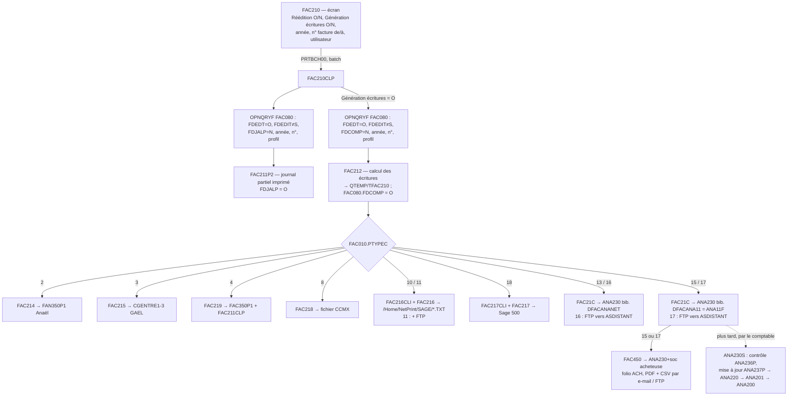

# Comptabilisation des factures de vente (F7) — FAC210 → FAC212 → FAC21C (→ FAC450)

> **But** : réécrire en .NET la génération des écritures de vente en produisant **le même contenu** dans les mêmes tables.
> **Sources lues** (01/11/2026) : `D:\dvp\sources AS400\NP11\` FAC210.rpgle, FAC210FM.dds, FAC210CLP.clp, FAC211P2.rpgle
> (mise à jour seulement), **FAC212.rpgle** (calcul des écritures), **FAC21C.rpgle** (écriture dans ANA230), FAC450.rpgle,
> TFAC210.pf, TFAC21L1 à L3.lf, FAC030L1.lf ; `ana11s\ANA230.pf` ; en-têtes de FAC214 à FAC219, FAC21D (autres logiciels).
> Documentation déjà existante, **non recopiée** ici : `D:\docs\Netprint\retrodoc-ANA400\fiches\ANA230-ECRITURES-BATCH.md`
> (le sas ANA230 côté comptabilité : contrôle ANA236P, intégration ANA237P → ANA220 → ANA201 → ANA200) ;
> `D:\docs\Netprint\retrodoc-saas\fiches\FAC450.md`, `FAC451.md` (inter-sociétés) ; projet WinDev
> `D:\Mes Projets\Module_comptable` (réécriture en cours d'ANA236P / ANA237P, spec `docs\superpowers\specs\2026-10-20-ecritures-batch-design.md`).
> Numéros de ligne : ceux du fichier cité (`cat -n` après suppression des octets nuls). Aucune requête sur la base.

---

## 0. En bref

1. **Pas de comptabilité dans NetPrint lui-même** : la comptabilisation **génère des écritures dans un fichier
   d'interface**, choisi par **FAC010.PTYPEC** (type de comptabilisation). Pour le paramétrage cité dans le projet
   (**PTYPEC = 15, « ANAEURO V1.1 »**), ce fichier est **ANA230** (« écritures batch ») de la bibliothèque de la
   comptabilité Axilog **ANA11F** (data area `DFACANA11`). C'est donc une **compta intégrée de la même maison, en sas** :
   les écritures n'arrivent dans l'historique comptable ANA200 qu'après **contrôle et mise à jour par l'utilisateur
   comptable** (ANA236P / ANA237P, ou le nouvel écran WinDev `Module_comptable`).
2. **Point d'entrée** : écran 5250 **FAC210** « Edition du journal partiel des ventes » (option « Génération écritures »),
   soumis en batch → **FAC210CLP** : journal partiel (FAC211P2), puis **FAC212** (écritures dans le fichier de travail
   QTEMP/TFAC210 + **FDCOMP = 'O'** dans FAC080), puis le programme propre au logiciel cible (**FAC21C** pour 15),
   puis **FAC450** (écritures d'achat chez la société sœur) si 15 ou 17.
3. **Une facture = une pièce** équilibrée en théorie : client TTC (débit ; avoir : crédit), produits HT par compte
   (FAC030 par code ligne × catégorie, ou compte de l'article), escompte (débit), TVA (crédit) **à un seul taux par facture**,
   TVA du port. **Aucun contrôle d'équilibre ni de compte** côté NetPrint : c'est ANA236P qui les fait au moment de
   l'intégration en compta.
4. **Rien n'est transactionnel** : FAC080 est marquée comptabilisée **avant** que les écritures soient copiées dans ANA230.
5. Le marquage FDCOMP sert aussi à la consultation (statut « comptabilisée ») et le lettrage d'ANA200 au statut « réglée »
   (voir `ConsultationFactures.md`).

---

## 1. Programmes et enchaînement



### 1.1 L'écran FAC210 (FAC210.rpgle, FAC210FM.dds)

| Zone | Valeur par défaut | Règle | Ligne |
|---|---|---|---|
| Société | société de la session (lecture AA0007, sinon fin) | non saisissable | FAC210 l. 308-314 |
| Réédition (EREP2) | `N` | `O` / `N` | l. 306 ; DDS l. 56-59 |
| Génération écritures (EREP1) | **`O`** | affichée seulement si PTYPEC ≠ 5 (indicateur 10) ; **reste à `O` même cachée** | l. 305, 320 ; DDS l. 61-65 |
| Année (2 chiffres) | année du jour | > 34 ⇒ 19AA, sinon 20AA (CL) | l. 304 ; FAC210CLP l. 147-154 |
| N° facture de / à | 0 / 0 | de = 0 ⇒ à = 999999 ; de > à ⇒ erreur GEN0007 | l. 239-243 |
| Utilisateur (profil) | blanc | doit exister dans AI00F ; blanc = tous | l. 247-250 ; CL l. 156-163 |

- Réédition **et** génération à `O` ⇒ fenêtre FAC210W « Vous avez demandé une réédition avec génération d'écritures.
  Voulez-vous continuer ? » (l. 255-266).
- **Pas de critère de période, de journal ni de date comptable** : la date comptable est la date de la facture (§ 3).
- Passage à FAC210CLP (PAR1) : société (1-4), compta (5), réédition (6), n° de / à (7-18), **PTYPEC** (19-20,
  `MOVEL PTYPEC PTYPCP` l. 276), membre BAG = FAC010.PSTEB (21-30), année (31-32), profil (33-42).
  Lancement par `PRTBCH00` (soumission batch, l. 279).

### 1.2 FAC210CLP

| Étape | Ce qui se passe | Lignes |
|---|---|---|
| Journal partiel | OPNQRYF FAC080 : `RSOC = soc & FDEDT = 'O' & FDEDIT ≠ 'S' & FDJALP dans ['N','N']` (réédition : `[' ','9']`) `& FDANNE = année & RNFAC dans [de, à] & FDPROF dans [profil]` ; tri RSOC, FDENS, FDMON, FDANNE, FDMOIS, FDVEN, FDTYPE, FDJOUR, RNFAC ; appel **FAC211P2** | 246-301 |
| Comptabilisation (si compta = O) | même sélection avec **`FDCOMP` dans ['N','N']** (réédition : `[' ','9']`) au lieu de FDJALP ; tri RSOC, FDENS, **FDCDEV**, FDANNE, FDMOIS, FDVEN, FDTYPE, FDJOUR, RNFAC | 307-346 |
| Fichiers de travail | `CRTDUPOBJ TFAC21*` de la bibliothèque `DPRINTF` vers **QTEMP** | 354-359 |
| Calcul | **FAC212** | 363 |
| Logiciel cible | selon PTYPEC (tableau ci-dessous) | 366-585 |
| Inter-sociétés | si PTYPEC = 15 ou 17 et compta = O : **FAC450** (bibliothèque ANA en PAR1 46-55) | 595-603 |
| Fin | `DLTF QTEMP/TFAC21*` | 605 |

| PTYPEC | Logiciel | Programme(s) | Destination | Lignes CL |
|---|---|---|---|---|
| 2 | Anaël V5 | FAC214 | FAN350P1 (bib. `DFACANAV5`) | 366-373 |
| 3 | GAEL | FAC215 | CGENTRE1/2/3, CGSOCIE (bib. `DFACGAEL`) | 375-385 |
| 4 | spécifique | FAC219 + FAC211CLP | FAC350P1 | 387-395 |
| 8 | CCMX | FAC218 | fichier plat CCMX (vidé avant, bib. `DFACCCMX`) | 398-413 |
| 10 | Sage ligne 100 | FAC216CLI (clients) + FAC216 | `/Home/NetPrint/SAGE/<nom>Ventes-<date>-<heure>.TXT` | 416-423 |
| 11 | Sage 100 par FTP | idem + script FTP (data area MIG035D) | idem + FTP | 426-463 |
| 18 | Sage 500 | FAC217CLI + FAC217 | IFS `/Home/NetPrint/SAGE/` | 466-473 |
| 13 | Axiana NET | FAC21C | ANA230 / ANA010 de `DFACANANET` | 478-486 |
| **15** | **ANAEURO V1.1** | **FAC21C** | **ANA230 / ANA010 de `DFACANA11`** | 489-497 |
| 16 | ANAEURO par FTP | FAC21C (ANA230 vidé avant) + FTP vers `ASDISTANT` + `CPYF … MBROPT(*ADD)` distant | 500-535 |
| 17 | ANAEURO V1.1 par FTP | idem, bib. `DFACANA11` | 537-585 |
| 5 | aucune comptabilisation | FAC212 tourne quand même (voir A1) | — |

> Le SaaS n'a besoin que du cas **15** (à confirmer, Q1). Les autres sont des interfaces vers des logiciels tiers
> d'anciens clients ; ils lisent tous le même TFAC210 produit par FAC212.

---

## 2. Sélection des factures

Une facture est comptabilisée si (FAC210CLP l. 328-337) :

```
FAC080.RSOC   = société de la session
FAC080.FDEDT  = 'O'                 -- facture éditée en définitif
FAC080.FDEDIT <> 'S'                -- pas supprimée
FAC080.FDCOMP = 'N'                 -- pas encore comptabilisée ; réédition : toute valeur entre ' ' et '9' (donc aussi 'O')
FAC080.FDANNE = 20AA (ou 19AA)      -- une seule année
FAC080.RNFAC  BETWEEN de AND à
FAC080.FDPROF BETWEEN profil AND profil   -- ou '' .. '9999999999' si blanc
ORDER BY RSOC, FDENS, FDCDEV, FDANNE, FDMOIS, FDVEN, FDTYPE, FDJOUR, RNFAC
```

- Ni le journal partiel (FDJALP) ni l'envoi ne conditionnent la comptabilisation.
- Factures **et** avoirs (FDTYPE `F` / autre) dans le même passage ; le journal diffère (§ 3.2).
- Lignes FAC100 dont le code ligne FGCDL = `'9'` (texte de la chaîne automatique) ignorées (FAC212 l. 553).

---

## 3. Écritures produites

### 3.1 FAC212 : calcul, une pièce par facture (fichier de travail TFAC210)

Ruptures (FAC212 l. 64-94) : RL9 = société + enseigne (rien), **RL8 = société, enseigne, devise, année, mois, code ligne
de vente FDVEN, type** → SPDET8 (l. 333-366) ; détail = une facture (SPDET l. 370-679). Indicateur **40 = facture**
(FDTYPE = `F`, l. 374) ; sinon avoir : **tous les sens sont inversés**.

Lectures communes :
- **Compte d'escompte** (une fois, l. 256-264) : FAC030 (société, RVENTE = `'ES'`, RCAT = `'**'`) → VGEN / VAUX / VTYPL.
- **Compte et taux de TVA** (à chaque rupture RL8, l. 336-364) : FAC030L1 (société, RVENTE = enseigne FDENS + code
  ligne FDVEN) **sur clé partielle** (première catégorie trouvée, pas forcément `**`) → VGENTV / VAUXTV / VTYPLT ;
  FAC020 (société, FDVEN) → LTVA ; FAC025 (société, LTVA) → taux = **CTTVA2 si date de la 1re facture du groupe ≥ CTDAT2
  et CTTVA2 ≠ 0, sinon CTXTVA**.

Ordre des écritures d'une facture et formules :

| # | Écriture | Compte (gén. / aux.) | Montant | Sens facture / avoir | HT | Lignes |
|---|---|---|---|---|---|---|
| 1 | **Escompte** (si FDMES ≠ 0) | FAC030 `ES`/`**` VGEN / VAUX | FDMES | D / C | `N` | 493-504 |
| 2 | **TVA sur le HT** (si > 0 et compte ≠ 0) | VGENTV / VAUXTV (FAC030 du code ligne FDVEN) | `arrondi((FDMTN − FDMES) × taux / 100)` (DIV(H)) | C / D | `N` | 450, 460-461, 511-527 |
| 3 | **Ventes et remises** (lignes LTYPE `V` et `R`), **cumulées par compte** dans la facture (100 comptes max) | voir 3.1.1 | Σ V − Σ R par compte ; une écriture au débit et/ou une au crédit par compte | C / D (remise : montant négatif dans le même sens) | `O` | 530-617, 774-844, 683-711 |
| 4 | **Autres lignes** (port `P`, port exonéré `E`, tout type ≠ V, R, T) : **une écriture par ligne** | VGEN / VAUX de la ligne | FGMTN | C / D | `O` | 846-862 |
| 5 | **TVA du port** (si FDPOT > 0 ou FDAPOT > 0) | VGENTV / VAUXTV du FAC030 de la **ligne de port P** | `arrondi(FDPOT × taux du code TVA de la ligne P / 100)` | C / D | `N` | 620-652, 865-876 |
| 6 | **Client TTC** | FDGENF / FDCLIF | `FDMTN + FDPOT + FDPOE − FDMES + FDTVA` (TVA **enregistrée**) | **D / C** | `C` | 464-467, 655-670 |

Puis mise à jour de FAC080 (§ 4).

#### 3.1.1 Compte de produit d'une ligne (sous-programme LIGNE, l. 729-878)

1. FAC020 (société, FGCDL) ; absent ⇒ ligne **ignorée** ; LTYPE `T` (texte) ⇒ ignorée (l. 732-736).
2. Si la ligne a un article : **SPF010.ACPVTE** (société, article, indice) > 0, sinon **SPF016.ACCVTE** (société,
   article, indice, enseigne, FGCDL) > 0 ⇒ compte général = ce compte, auxiliaire blanc (l. 739-753).
3. Sinon, pour LTYPE ≠ `R` : **FAC030 (société, RVENTE = enseigne + FGCDL, RCAT = catégorie de l'élément FECAT)**,
   à défaut **RCAT = `'**'`** ; absent ⇒ ligne **ignorée** (l. 756-770).
4. Remise `R` : pas de lecture FAC030, elle s'impute sur le **compte de la dernière ligne V de l'élément** (SVGEN,
   remis à 0 à chaque élément FAC090, l. 536) (l. 813-844).
5. **Contrepartie** : lignes HT ⇒ client facturé (FDGENF / FDCLIF, l. 445-446) ; ligne client ⇒ **premier compte de
   vente** de la facture (GENSV / AUXSV, indicateur 41, l. 663-664, 794-795).
6. Auxiliaire `00000000` (et variantes) ramené à blanc (l. 585-590).

#### 3.1.2 Colonnes de TFAC210 (ECRITU, l. 882-933)

| Colonne | Valeur | Ligne |
|---|---|---|
| RSOC (WSTE) | société ; si AA0007.SOP03 = `O` (gestion par enseigne) et PRT320F.ESOCC ≠ 0 : **société comptable de l'enseigne** | 884-892 |
| WGEN / WAUX | compte général / auxiliaire (§ 3.1) | 893-894 |
| WGENC / WAUXC | contrepartie (§ 3.1.1, 5) | 895-896 |
| WANP / WMOISP / WJOURP | **date de la facture** (FDANNE / FDMOIS / FDJOUR) = date comptable | 897-899 |
| WJAL | facture : **FAC010.PJALV** ; avoir : **FAC010.PJALA** | 900-901 |
| WPIECE | n° de facture ; si FAC010.PPREFX = `O` : 2 derniers chiffres de l'année + n° (`AA` + 6 chiffres) | 903-909 |
| WLIB | `Fac ` / `Av. ` + 21 premiers caractères du nom figé FDNOM, sinon AA0003.CNOM | 389-403, 941-943 |
| DMTEUR | montant (euros) ; **DMT (francs) n'est plus alimenté** (0) | 912 |
| SENS | `D` / `C` | — |
| WDEV / WCOURS | FDCDEV / FDCOURD | 914-915 |
| WECHA / M / J | facture : **échéance** FDECHA/M/J ; avoir : **date de la facture** | 917-922 |
| WTVA / WCTVA / WZTVA | code TVA et codes BAG du **dernier** FAC025 / FAC020 lu | 923-925 |
| WREGLT / WRELE / WREP | FDRGLT / FDRELE / FDREP | 926-928 |
| WTYPL | code ligne BAG (FAC030.VTYPL, `TTC` pour le client) | 929 |
| HT | `O` produit, `N` TVA / escompte, `C` client, `V` TVA en CCMX | — |
| WWS / WINT | `'FAC'` / AAMMJJ + heure, **+ 1 par facture** (n° interne de pièce, propre au passage) | 267-271, 443 |
| WNOLIG | n° de ligne dans la facture (1, 2, …) | 930 |
| WDEST, WQTE, WCAT, WDOSS, WDCLE | utilisés seulement en CCMX (PTYPEC 8) et Sage 500 (18 : WDEST = AA0003.CTELEX) | 409-439, 665-668 |

### 3.2 FAC21C : copie dans ANA230 (PTYPEC 13, 15, 16, 17)

- Paramètres FAC010 (l. 170-174) : **PCRITB** = société comptable forcée (si ≠ 0, remplace RSOC) ; **PCENT = `O`** ⇒
  centralisation.
- **Sans centralisation** (MAIN1, l. 232-255) : lecture TFAC21L2 (RSOC, WWS, WINT, WGEN) = **pièce par pièce** ;
  toutes les lignes sont recopiées ; nouveau RINT à chaque pièce, RLIGNE / RNUMF repartent à 1.
- **Avec centralisation** (MAIN, l. 183-228) : lecture TFAC210 (RSOC, WJAL, date, WGEN, WAUX, WTVA, SENS) ; les lignes
  client (HT = `C`) sont recopiées une à une, **toutes les autres sont cumulées par société / journal / jour / compte /
  code TVA / sens** en une ligne libellée `CENTRALISATION`, sans n° de pièce (TOTAL, l. 451-499) ; un seul RINT par
  société / journal / mois ⇒ **tout le mois est une seule pièce** pour le contrôle d'équilibre d'ANA236P.

Colonnes d'ANA230 écrites (ECRITU l. 390-446 ; TOTAL l. 451-499) — les autres restent à zéro / blanc :

| Colonne ANA230 | Ligne recopiée | Ligne de centralisation |
|---|---|---|
| RSOC | PCRITB si ≠ 0, sinon RSOC de TFAC210 | idem |
| RDATA / RDATM / RDATJ | WANP / WMOISP / WJOURP | **RDATA non alimenté** (garde la valeur de l'écriture précédente, l. 467) / mois / jour |
| RDATO (date d'origine) | JJMMAAAA de la date comptable | idem |
| RFOLIO | **`'PRT'`** | `'PRT'` |
| RJAL (2 caractères) | WJAL (3) **tronqué** aux 2 premiers | idem |
| RGEN / RAUX | WGEN / WAUX | idem |
| RGENC / RAUXC | sans centralisation, lignes HT `O` : compte client de la pièce (SAVGEN / SAVCLI, l. 344-345, 412-417) ; sinon 0 | 0 |
| RPIECE | WPIECE | blanc |
| RLIB | WLIB | `CENTRALISATION` |
| RMEUR | DMTEUR | total cumulé |
| RMONT | 0 | 0 |
| RMORI | `'E'` | `'E'` |
| RSENS | SENS | idem |
| RDECH | AAAAMMJJ d'échéance | 0 |
| RTVA | WTVA | idem |
| RRGLT / RRELE / RREP | WREGLT / WRELE / WREP | blancs |
| RLIGNE / RNUMF | +1 à chaque écriture | idem |
| **RWS** | **`'EB'`** | `'EB'` |
| RINT | n° interne JJMMAAhhmmss (UDATE + heure ; **attente active** jusqu'au changement de seconde, l. 272-277, 289-294) | idem |

> ANA210 (consultation compta) reconnaît les factures importées par `MECR = 'EB'` et `MFOLIO = 'PRT'` : ces deux valeurs
> doivent être conservées (spec Module_comptable, § contraintes).

### 3.3 FAC450 : achats chez la société sœur (PTYPEC 15 / 17)

Résumé de `FAC450.md`, précisé par les sources (FAC450 l. 216-425) : pour chaque pièce de TFAC210 dont le client est
déclaré dans **FACCI1** (société vendeuse, FGENC / FAUXC), FAC450 **supprime et recrée** `ANA230<soc acheteuse>` dans
la bibliothèque ANA, et y écrit la pièce **sens inversé**, folio **`ACH`**, journal FACCI1.FJALA, mode FACCI1.FMODE :
la ligne client devient le **fournisseur** FACCI1.FGENF / FAUXF ; les autres comptes sont traduits par **FACCI2**
(SOCQV, FGENPR / FAUXPR → FGENCH / FAUXCH) — **0 si absents** (l. 270-278) ; libellé = 4 premiers caractères + raison
sociale du vendeur (l. 373). Puis FAC450CLP : PDF (FAC202P5), CSV, e-mail et FTP. Ce CSV est celui que le module
comptable WinDev importe chez l'acheteur.

---

## 4. Mises à jour de FAC080 et autres tables

| Table | Colonnes | Valeur | Programme / ligne |
|---|---|---|---|
| FAC080 | FDCOMP | `'O'` | FAC212 l. 673 |
| FAC080 | FDCODA / FDCODM / FDCODJ | date du jour (année sur 4 chiffres, mois, jour) | FAC212 l. 674-677 |
| FAC080 | FDJALP / FDJLPA / FDJLPM / FDJLPJ | `'O'` + date du jour (journal partiel imprimé, **même sans compta**) | FAC211P2 l. 575-579 |
| QTEMP/TFAC210 | toutes (§ 3.1.2) | — | FAC212 l. 931 |
| ANA11F/ANA230 | § 3.2 (ajout, sans vider le fichier en 15) | — | FAC21C l. 444, 497 |
| ANA230<soc> | § 3.3 (fichier recréé) | — | FAC450 l. 330-354, 423 |

Ne sont **pas** touchés : FDJALM (journal mensuel FAC220/FAC221, l. 572), FDTRAT (traite), FDEDIT, l'acompte.

---

## 5. Paramètres et tables lues

| Table | Clé | Colonnes utilisées |
|---|---|---|
| FAC010 | RSOC | PTYPEC (type de compta), PJALV / PJALA (journaux facture / avoir, 3 car.), PPREFX (année en préfixe de pièce), PCENT (centralisation), PCRITB (société comptable forcée), PSTEB |
| AA0007 | RSOC | SOP03 (gestion par enseigne) |
| PRT320F | RSOC, enseigne | ESOCC (société comptable de l'enseigne) |
| FAC020 | RSOC, code ligne | LTYPE (V, R, P, E, T…), LTVA |
| FAC025 | RSOC, code TVA | CTXTVA, CTTVA2 + CTDAT2 (taux daté), CCTVA, CZTVA |
| FAC030 (L1) | RSOC, RVENTE (= enseigne + code ligne, ou `ES`), RCAT (catégorie, `**` par défaut) | VGEN / VAUX (produit), VTYPL, VGENTV / VAUXTV (TVA), VTYPLT |
| SPF010 / SPF016 | article, indice (+ enseigne, code ligne) | ACPVTE / ACCVTE (compte de vente de l'article, prioritaire) |
| AA0003 | RSOC, FDGENF, FDCLIF | CNOM (libellé), CTELEX (Sage 500) |
| FAC080 / FAC090 / FAC100 | facture / élément / ligne | FDTYPE, FDENS, FDVEN, FDMTN, FDPOT, FDPOE, FDMES, FDTVA, FDECH*, FDRGLT, FDRELE, FDREP, FDNOM, FDCDEV ; FECAT ; FGCDL, FGART, FGIND, FGMTN |
| FACCI1 / FACCI2 | société vendeuse, client / compte | inter-sociétés (§ 3.3) |

Écran de paramétrage existant des comptes inter-sociétés : WinDev `D:\Mes Projets\ParamCptaInterSte` (FACCI1, FACCI2).

---

## 6. Anomalies (à ne pas reproduire)

| # | Constat | Réf. |
|---|---|---|
| A1 | Condition CL `Compta = O et Type ≠ '5' OU Compta = O et Type ≠ '05'` toujours vraie ; avec la zone cachée restant à `O`, **PTYPEC 5 marque les factures comptabilisées sans écrire d'écriture**. | FAC210CLP l. 307-308 ; FAC210 l. 305, 320 |
| A2 | **Pas de transaction** : FDCOMP = `O` est écrit par FAC212 **avant** la copie dans ANA230 ; un échec de FAC21C (ou de FTP) laisse des factures « comptabilisées » sans écritures. | FAC212 l. 673-677 ; CL l. 363-497 |
| A3 | **Aucun contrôle** d'équilibre, de compte ni de période dans NetPrint : compte FAC030 absent ⇒ **ligne de vente ignorée** ; compte de TVA à 0 ⇒ **TVA non écrite** ; escompte sans compte ⇒ écriture au compte 0. Seul ANA236P détecte ensuite le déséquilibre. | FAC212 l. 734, 767, 511-512, 256-264 |
| A4 | **Un seul taux de TVA par facture** (celui du code ligne de vente de l'en-tête) appliqué à `FDMTN − FDMES` ; le client est au TTC **enregistré** (FDTVA) : facture multi-taux ou écart d'arrondi ⇒ pièce déséquilibrée. | l. 450-461, 464-467 |
| A5 | Taux et compte de TVA déterminés à la rupture **mois / code ligne** (date de la 1re facture du groupe pour le taux daté) et **non remis à zéro** entre factures (GENTVA, GENTVApt : valeurs de la facture précédente si non trouvées). | l. 333-364, 873-875 |
| A6 | FAC030 de la TVA lue sur **clé partielle** (première catégorie venue, pas `**`). | l. 340-343 |
| A7 | Remise imputée sur le compte de la **dernière ligne V de l'élément** ; une remise placée avant toute vente est perdue. | l. 813-844, 536 |
| A8 | WTVA / WCTVA des lignes de produit = **dernier** code TVA lu (pas celui de la ligne). | l. 593-596 |
| A9 | Plus de 100 comptes dans une facture : cumul dans la case 1. | l. 686-694 |
| A10 | ANA230.RJAL sur 2 caractères ← journal FAC010 sur 3 : **troncature** silencieuse. | FAC21C l. 418 |
| A11 | Centralisation : RDATA non alimenté sur la ligne de centralisation ; un seul RINT par mois ⇒ **une pièce = tout le mois**. | FAC21C l. 266-278, 467 |
| A12 | RINT : **attente active d'une seconde par facture** (sans centralisation) ; date du travail sur 6 chiffres. | FAC21C l. 289-294 |
| A13 | Réédition + génération : re-génère des factures déjà comptabilisées (FDCOMP ' '..'9') ⇒ **doublons** dans ANA230 (seule protection : la fenêtre de confirmation). | CL l. 315-324 ; FAC210 l. 255-266 |
| A14 | PTYPEC 16 / 17 : `CLRPFM ANA230` **vide tout le sas local** avant d'y écrire ; identifiants FTP en dur (`FTP` / `FTP`). | CL l. 507, 544, 524-526 |
| A15 | FAC450 : ANA230<soc> **supprimé et recréé** à chaque passage (fichier non intégré perdu) ; compte FACCI2 absent ⇒ compte 0 ; RMONT = DMT (toujours 0). | FAC450 l. 330-354, 270-278, 374 |
| A16 | Acompte (FDACPT…) jamais comptabilisé ici. | — (à confirmer, Q5) |
| A17 | Sélection sur **une seule année** de facture : une plage de n° à cheval sur deux années demande deux passages. | CL l. 333 |

---

## 7. Questions ouvertes pour David

1. **Type de comptabilisation** des sociétés suivies (8, 29, 55, Clarins) : PTYPEC = 15 partout ? Des sociétés en
   17 (FTP vers « ASDISTANT ») ou en Sage (10/11/18) à reprendre ?
2. **Centralisation** (FAC010.PCENT) : utilisée ? Si non, on ne reprend que le mode pièce par pièce.
3. **TVA multi-taux** : le prototype calcule la TVA par taux (F2). Quel compte de TVA par taux ? FAC025 n'en a pas ;
   proposition : FAC030.VGENTV du code ligne de chaque ligne (ou un compte par code TVA à créer).
   Et l'arrondi : une ligne de TVA par taux égale à la TVA enregistrée dans FAC080 (pour garantir l'équilibre) ?
4. **Escompte** : garder une écriture d'escompte au débit et la TVA calculée sur le HT net d'escompte ?
5. **Acompte** : est-il comptabilisé ailleurs (règlement saisi en compta) ? Confirmation qu'il ne doit pas apparaître.
6. **Inter-sociétés (FAC450)** : dans F7, ou plus tard ? Le SaaS pourrait écrire directement dans le sas de la société
   acheteuse (même base) au lieu du CSV par e-mail.
7. **Date comptable = date de facture** : que faire si la période est close en compta (ANA236P le refusera, BAT0003) ?
   Et le journal sur 3 caractères tronqué à 2 dans ANA230 : les valeurs de PJALV / PJALA sont-elles sur 2 caractères ?
8. **Lancement** : la comptabilisation reste-t-elle liée au journal partiel imprimé, ou devient-elle une action
   distincte (liste des factures éditées non comptabilisées → « Comptabiliser ») ? La réédition avec génération
   (doublons) est-elle à supprimer ?
9. ANA230 (bibliothèque ANA11F) est-il **journalisé** sur NP11F de test / en production (la spec du module comptable
   le propose) ? Nécessaire pour écrire FAC080 et ANA230 dans une même transaction.

---

### Réponses trouvées dans NP11F (01/11)

- Q1 : FAC010.PTYPEC = **15** (compta Axilog intégrée, sas ANA230) pour les sociétés 8, 11, 28, 29, 31 ; **10** pour la société 55 ;
  **5** pour la société 56 (marque comptabilisée sans écriture, voir anomalie).
- Q2 : FAC010.PCENT = **N** partout : pas de centralisation, seulement le mode pièce par pièce.
- Q7 (journal) : PJALV / PJALA valent 02, 01, VE, AV, VT : 2 caractères utiles, la troncature à 2 est sans effet.
- Q9 : ANA11F.ANA230 est **journalisé** (ANA200 ne l'est pas) : FAC080 et ANA230 peuvent être écrits dans une même transaction.

## 8. Pistes pour le SaaS

- **Écrire directement dans ANA230** (bibliothèque comptable paramétrée, `BibliothequeCompta`, défaut ANA11F, comme
  `ConsultationFactures`), sans TFAC210 ni programme IBM i ; le sas, le contrôle et l'intégration restent ceux de la
  comptabilité (ANA236P / ANA237P ou l'écran WinDev `Module_comptable`). Garder **RFOLIO = `PRT`, RWS = `EB`,
  RMORI = `E`**, RINT unique (12 chiffres) **sans attente** (ex. horodatage + compteur, vérifié absent du sas, règle
  « pièce déjà présente » du module comptable).
- **Service de calcul pur** `EcrituresFacture` (dans `Services/`) : facture → liste d'écritures, réutilisant
  `CalculFacture` (TVA par taux) ; **contrôle d'équilibre et de comptes avant écriture** (refus avec message, pas
  d'écriture partielle) ; tests unitaires sur les factures déjà vérifiées en F2 (comparaison avec ce que FAC212
  aurait produit, aux anomalies A4-A9 près).
- **Une transaction** par lot : INSERT ANA230 + `UPDATE FAC080 SET FDCOMP = 'O', FDCODA/M/J = date du jour`
  (condition `FDCOMP = 'N'` dans le WHERE pour éviter les doubles passages concurrents). Si ANA230 n'est pas journalisé :
  ordre FAC080 d'abord en transaction puis compensation, comme le module comptable.
- Écran : liste des factures **éditées non comptabilisées** (critères : n° de / à, dates, profil), aperçu des écritures
  (pièce par pièce, totaux débit / crédit), bouton « Comptabiliser » avec confirmation ; pas de « réédition avec
  génération » ; droit PRT000P1 (option « MAJ »).
- Plus tard : inter-sociétés en écriture directe dans le sas de la société acheteuse (FACCI1 / FACCI2), avec contrôle
  des correspondances de comptes manquantes avant écriture.
