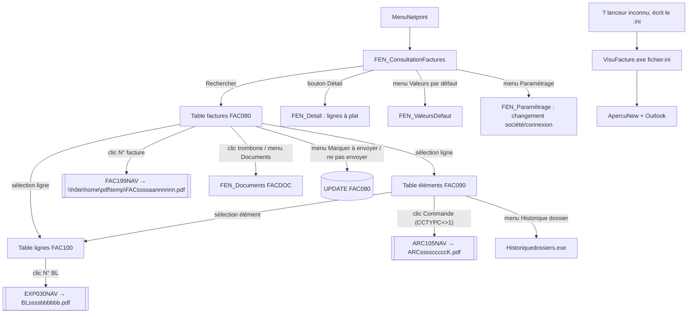

# ConsultationFactures et VisuFacture — Consultation des factures, visualisation et documents

> *Sources :* projets WinDev `D:\Mes Projets\ConsultationFactures` (FEN_ConsultationFactures, FEN_Detail, FEN_Documents, FEN_ValeursDefaut ; fenêtres de recherche partagées FEN_RechercheClient, FEN_RecDossiers, FEN_RecArticle, FEN_RecReprésentant, FEN_Recfabricant, FEN_RecCodeVente, FEN_RecNAdrLiv, FEN_Paramétrage hors projet) et `D:\Mes Projets\VisuFacture` (FEN_Impression, ApercuNew, ETAT_Facture, modèles « Aperçu impression »).
> *Versions lues :* fichiers racine (ConsultationFactures 2026-06-24, VisuFacture 2026-10-28). Les dossiers `Svg_*` sont des sauvegardes, non analysées.
> *Programmes IBM i appelés :* FAC199NAV (PDF facture), ARC105NAV (PDF ARC), EXP030NAV (PDF BL), via `QSYS2.QCMDEXC`.
> *Extractions :* `FEN_*.txt`, `ApercuNew.txt`, `ETAT_Facture.txt` dans ce dossier.
> *Date d'analyse :* 2026-10-31.

## 1. Rôle

**ConsultationFactures** est l'écran de recherche et de consultation des factures et avoirs émis (FAC080/090/100), en lecture seule sur les montants, avec :
- recherche multicritère (client, n°, commande, BL, appel, article, réf. imprimé, représentant, enseigne, dates, échéance, montants, adresse de livraison, fabricant, code ligne) ;
- affichage maître/détail : factures → éléments (commandes/dossiers facturés) → lignes ;
- statut d'édition, statut d'envoi électronique, statut « réglée » (lettrage comptable, si compta intégrée ANA) ;
- ouverture du **PDF de la facture** (régénéré par l'IBM i à chaque clic), de l'**ARC** de la commande et du **BL** ;
- **pièces jointes** libres par facture (table FACDOC, BLOB) avec glisser-déposer de fichiers ou de mails Outlook ;
- marquage « à envoyer / ne pas envoyer » pour l'envoi automatique des factures (écriture dans FAC080) ;
- vue détail « à plat » (toutes les lignes de toutes les factures trouvées).

**VisuFacture** est une visionneuse autonome : elle reçoit un fichier .ini contenant l'**image texte (spool) d'une facture** et la met en page (logo, cadres, polices) en aperçu et PDF, avec bouton d'envoi par Outlook. Elle n'accède pas à la base. Elle n'est **pas appelée** par ConsultationFactures (qui passe par FAC199NAV).

## 2. Fenêtres et enchaînement



Rien n'est chargé à l'ouverture (les tables sont vides jusqu'au clic sur Rechercher), conformément à la charte cible.

## 3. Initialisation (InitVarGlobales, à l'ouverture et après Paramétrage)

| Lecture | SQL | Usage |
|---|---|---|
| Bibliothèque compta | `parametre.INI [PARAM] BibliothequeCompta` (défaut `ANA11F`) | préfixe des tables ANA200/ANA060 |
| Société | `select srs, sop03 from aa0007 where rsoc = :soc` | titre « Consultation des factures (Société n RS) » ; SOP03='O' = gestion par enseigne |
| Enseignes (si SOP03='O') | `select rensei, enrs from prt320f where rsoc = :soc and entag <> '*'` | combo Enseigne (sinon masquée) |
| Représentant limité | `select rrepr, ilimit from b000f where rsoc = :soc and iprof = :PROFIL and itag <> '*'` | si ILIMIT='O' : critère représentant forcé à RREPR et grisé |
| Paramètres facturation | `select ptypec, pcritb, pprefx from fac010 where rsoc = :soc` | PTYPEC=15 (compta intégrée ANA) → interrupteur « Avec réglées » et colonne « Réglée » visibles ; PCRITB = société comptable ; PPREFX lu mais plus utilisé (code commenté) |
| Groupe de l'utilisateur | `select agroup from ai00f where rprf = :PROFIL` | droits |
| Droits envoi | `select apgm, aopt01, aopt08, ausr, agroup from prt000p1 where apgm = 'PCENVFACT' and (agroup = :groupe or ausr = :PROFIL)` | grise le marquage d'envoi |
| Droits documents | `select aopt01 from prt000p1 where apgm='PCDOCUMENT' and agroup=:groupe` puis `… and ausr=:PROFIL` | interdit la suppression de pièces jointes |
| Compte général par défaut | `COL_ProcéduresGlobales.CpteGen` | pré-rempli dans Client DO et Client facturé |
| Valeur par défaut « Avec réglées » | `ConsultationFactures.ini [GENERAL] AvecReglees` | interrupteur |

## 4. Critères de recherche et contrôles (procédure Controle)

Critères : Client donneur d'ordre (gén./aux., F4), Client facturé (gén./aux., F4), N° facture, Réf. commande, N° commande + clé (F4), N° BL, N° appel, Article + indice (F4), Réf. imprimé, Représentant (F4), Enseigne, Date de facture du/au, Échéance du/au, Avec réglées (+ date de règlement), Montant HT de/à, Montant TTC de/à, Fabricant (F4), Code ligne (F4), Adresse BL (n° d'adresse de livraison, F4).

Contrôles (messages `Info`) :
- au moins un critère parmi client DO, client facturé, n° facture, réf. cde, n° cde, BL, appel, article, réf. imprimé, représentant, enseigne, dates facture, dates échéance, montants (fabricant, code ligne et adresse BL ne suffisent pas seuls) ;
- client DO / facturé : existe dans AA0003 (`rsoc, rgen, rcli`) — « Le client n'existe pas. » ;
- commande : existe dans AB001 (`rsoc, rdoss [, ccdcle]`) et **CCTYPC ≠ '2'** — « La commande ne doit pas être de type fabrication mise en stock. » ;
- dates début ≤ fin (facture, échéance) ; montants HT et TTC début ≤ fin ;
- article : existe dans SPF010 (`aartic, aindic`) ;
- représentant : existe dans B000F ;
- fabricant : profil AI00F (`acini = :fab`) avec ACFAB='O' — « Ce profil n'est pas fabricant. » ;
- adresse BL : exige le client DO (également pour ouvrir la recherche F4).

Dates saisies invalides → remplacées par la date du jour.

## 5. Requête principale (BTN_Chargement)

### 5.1 SELECT et jointures

```sql
select fdgenf, fdclif, fdgend, fdclid, fdanne, fdmois, fdjour, a.rnfac, fdecha, fdechm, fdechj,
       fdmtn, fdtva, fdpot, fdpoe, fdmes, fdcpt, fdrglt, fdatt, b.crfexp, fdedit, fdcomp, b.cadrs,
       fdrue1, fdrue2, fdpost, fdvill, b.cmodir /*mot directeur client facturé*/, h.cmodir /*DO*/,
       fdtype, fdrep, fdnom, fdtage, fddatee, fdheure, fdmanau, fdmethe, fdtypee, fdnone,
       (select count(*) from facdoc where rsoc = :soc and rnfac = a.rnfac and fdanne = a.fdanne
          and fdmois = a.fdmois and fdjour = a.fdjour)            -- nb pièces jointes
       [, mdlet]                                                  -- si PTYPEC = 15
from fac080 a
left join aa0003 b on a.rsoc = b.rsoc and a.fdgenf = b.rgen and a.fdclif = b.rcli   -- client facturé
left join fac090 c on a.rsoc = c.rsoc and a.rnfac = c.rnfac and a.fdanne = c.feanne
                  and a.fdmois = c.femois and a.fdjour = c.fejour                     -- éléments
left join aa0003 h on a.rsoc = h.rsoc and a.fdgend = h.rgen and a.fdclid = h.rcli   -- donneur d'ordre
-- si PTYPEC = 15 et SOP03 = 'O' (enseignes : société comptable par enseigne)
left join prt320f q on a.rsoc = q.rsoc and a.fdens = q.rensei
left join <BibCompta>.ana200 p on q.esocc = p.rsoc
       and (p.mpiec = concat(substr(a.fdanne,3,2), digits(a.rnfac)) or p.mpiec = digits(a.rnfac))
       and p.mgen = a.fdgenf and p.maux = a.fdclif
       and p.mdato = a.fdanne*10000 + a.fdmois*100 + a.fdjour
-- si PTYPEC = 15 et SOP03 <> 'O' : même jointure ana200 avec p.rsoc = PCRITB (FAC010)
where a.rsoc = :soc  ...filtres...
  [and (p.marq1 <> '*' or p.marq1 is null)]   -- si PTYPEC = 15 : écritures non annulées
  and fdedit <> 'S'                           -- factures supprimées exclues
  [and (a.rnfac, a.fdanne, a.fdmois, a.fdjour) in
       (select hnofac, hdafaa, hdafam, hdafaj from exp010 a join exp009 b
          on a.rsoc = b.rsoc and a.hnobl = b.hnobl
        where a.rsoc = :soc and b.hnadre = :adresseBL)]   -- si Adresse BL
group by <toutes les colonnes du select>      -- dédoublonnage (jointure fac090 / ana200)
order by a.rnfac, fdanne, fdmois, fdjour
```

Clé d'une facture : **RSOC + RNFAC + date (FDANNE, FDMOIS, FDJOUR)** (le n° seul n'est pas unique : numérotation annuelle possible).

### 5.2 Filtres

**Si un n° de facture est saisi**, seuls s'appliquent : `a.rnfac = :n`, dates de facture, client DO, client facturé, et (PTYPEC=15) le filtre réglées. Les autres critères sont **ignorés**.

Sinon :

| Critère | Filtre |
|---|---|
| Client DO | `fdgend = :gen and fdclid = :aux` |
| Client facturé | `fdgenf = :gen and fdclif = :aux` |
| Réf. commande | `:ref in (select ccrefc from ab001 t where c.rsoc=t.rsoc and c.fedoss=t.rdoss and c.fecle=t.ccdcle) or fdref = :ref` |
| N° commande [clé] | `fedoss = :n [and fecle = :cle]` |
| N° BL | `a.rnfac in (select x.rnfac from fac100 x left join exp010 y on x.rsoc=y.rsoc and x.rnfac=y.hnofac and x.fganne=y.hdafaa and x.fgmois=y.hdafam and x.fgjour=y.hdafaj and x.fgnel=y.hnoelt left join ab001 z on … where <corrélé à c, élément c.fenum = x.fgnel> and y.hnobl = :bl)` |
| N° appel | `a.rnfac in (select m.rnfac from neg100 j left join fac090 m on j.rsoc=m.rsoc and j.rdoss=m.fedoss and j.dndcle=m.fecle left join fac100 l on … and j.dnnlig=l.fgligd where <corrélé à c> and dnappe = :appel)` |
| Article [indice] | `(:art[, :ind]) in (select (fgart[, fdind]) from fac100 e where <corrélé à c, élément>)` — ⚠ `fdind` au lieu de `fgind` (voir anomalies) |
| Réf. imprimé | `:ref in (select arfimp from spf010 g join fac100 i on g.aartic=i.fgart and g.aindic=i.fgind where <corrélé>) or :ref in (select ccrfim from ab001 s where <dossier de c>)` |
| Code ligne | `a.rnfac in (select aa.rnfac from fac100 aa where <corrélé> and aa.fgcdl = :code)` |
| Représentant | `fdrep = :rep` |
| Fabricant | `h.cinat = :fab` (agent technique du **client donneur d'ordre**) |
| Date facture | `fdanne*10000+fdmois*100+fdjour between / >= / <= :aaaammjj` |
| Échéance | `fdecha*10000+fdechm*100+fdechj between / >= / <=` |
| Journal (PTYPEC=15) | `mjal is null or mjal in (select fjal from <BibCompta>.ana060 r where r.rsoc = <q.esocc ou PCRITB> and r.ftype = 'V')` |
| Réglées (PTYPEC=15) | sans « Avec réglées » : `mdlet = 0 or mdlet is null` ; avec et date de règlement saisie : `mdlet = :date` |
| Enseigne | `fdens = :ens` |
| Montant HT | `fdmtn between / >= / <=` (valeur 0 = non saisi) |
| Montant TTC | `(fdmtn + fdtva) between / >= / <=` |

Pas de garde-fou de volume (aucun `fetch first`).

## 6. Colonnes affichées et calculs

### 6.1 Table des factures (TABLE_FAC080)

| Colonne | Source / calcul |
|---|---|
| Client facturé | `b.cmodir` (mot directeur AA0003) |
| Client DO | `h.cmodir` |
| Date facture | FDANNE·FDMOIS·FDJOUR |
| N° facture | RNFAC (bleu souligné = lien PDF) |
| Échéance | FDECHA·FDECHM·FDECHJ, vide si FDECHA=0 |
| **Montant TTC** | **FDMTN + FDPOT − FDMES + FDPOE + FDTVA** |
| TVA | FDTVA |
| Port | FDPOT + FDPOE (taxable + exonéré) |
| Escompte | FDMES |
| HT | FDMTN (HT des lignes, hors port, avant escompte) |
| Acompte | FDCPT (acompte déjà versé ; **non déduit** du TTC affiché) |
| Mode de règlement | FDRGLT (code brut) |
| Réglée / Date de règlement | PTYPEC=15 : MDLET ≠ 0 → réglée ; date = MDLET (date de lettrage ANA200) |
| À l'attention de | FDATT |
| TVA intracom. | AA0003.CRFEXP du client facturé |
| Statut | FDEDIT : `O` « A éditer », `E` « Edité » si FDCOMP='N' sinon « Edt + Cpt » (édité + comptabilisé), `A` « Attente » ; `S` exclu |
| Adr. spéciale | AA0003.CADRS='O' (case) |
| Raison sociale, rue 1, rue 2, CP, ville | FDNOM, FDRUE1, FDRUE2, FDPOST, FDVILL (adresse figée sur la facture) |
| Représentant | FDREP |
| Envoyée | FDTAGE='O' → « Oui » |
| Date/heure d'envoi | FDDATEE (AAAAMMJJ) + FDHEURE (HHMMSS) |
| Type d'envoi | FDMANAU `M` Manuel / `A` Auto ; « Ignorée » si FDNONE='O' |
| Type fichier | FDMETHE `M` « MAIL - », `F` « FTP - », `W` « web service - » + FDTYPEE (ex. PDF, XML…) |
| Trombone | image si au moins un document FACDOC |
| Colonnes cachées | année, mois, jour, FDTYPE, FDTAGE, FDNONE |

**Avoirs** (FDTYPE='A') : ligne en rouge clair, FDMTN, FDTVA, FDPOT, FDPOE, FDMES, FDCPT **multipliés par −1** à l'affichage (stockés positifs).

### 6.2 Table des éléments (TABLE_FAC090), sur sélection d'une facture

```sql
select fedoss, fecle, ccrefc, ccdata, ccdatm, ccdatj, feorte, fetxc, fenom, fetxo, femto, fenum, cctypc, ccrfim, ccrep
from fac090 a left join ab001 b on a.rsoc=b.rsoc and a.fedoss=b.rdoss and a.fecle=b.ccdcle
where a.rsoc=:soc and a.rnfac=:n and feanne=:a and femois=:m and fejour=:j
```
Colonnes : Commande (`FEDOSS/FECLE`, lien ARC si CCTYPC ≠ '1'), Réf. commande (CCREFC), Date commande (CCDATA…), Origine technique (FEORTE), Taux de commission (FETXC), Honoraire : nom (FENOM), taux (FETXO), montant (FEMTO), Réf. imprimé (AB001.CCRFIM si CCTYPC='1'), Représentant (CCREP).

### 6.3 Table des lignes (TABLE_FAC100)

Sur sélection d'une facture : toutes les lignes ; sur sélection d'un élément : lignes de l'élément (`and fgnel = :element`).

```sql
select fgcdl, fgart, fgind, fgqte, fgdes, fgpu, fgun, fgmtn, fgtcol, h.hnobl, hdexaa, hdexmm, hdexjj,
       fedoss, fecle, ccrefc, dnappe, ltype, arfimp, dnnorm, ccrfim, cctypc
from fac100 a
left join fac090 c on a.rsoc=c.rsoc and a.rnfac=c.rnfac and a.fganne=c.feanne and a.fgmois=c.femois and a.fgjour=c.fejour and a.fgnel=c.fenum
left join ab001 d on c.rsoc=d.rsoc and c.fedoss=d.rdoss and c.fecle=d.ccdcle
left join exp010 h on a.rsoc=h.rsoc and a.rnfac=h.hnofac and a.fganne=h.hdafaa and a.fgmois=h.hdafam and a.fgjour=h.hdafaj
                   and a.fgnel=h.hnoelt and a.fgbl=h.hnobl        -- (and fgbl=hnobl absent dans la variante « élément »)
left join exp009 b on h.rsoc=b.rsoc and h.hnobl=b.hnobl
left join neg100 e on c.rsoc=e.rsoc and c.fedoss=e.rdoss and c.fecle=e.dndcle and a.fgligd=e.dnnlig
left join fac020 f on a.rsoc=f.rsoc and a.fgcdl=f.rligne
left join spf010 g on a.rsoc=g.rsoc and a.fgart=g.aartic and a.fgind=g.aindic
where a.rsoc=:soc and a.rnfac=:n and feanne=:a and femois=:m and fejour=:j [and fgnel=:el]
order by fgnel, fgnlg
```

Règles :
- Lignes de **texte** (FGCDL='9' ou FAC020.LTYPE='T') non affichées : leur désignation est **concaténée dans l'infobulle** de la désignation de la ligne précédente.
- Article = `FGART[/FGIND]`.
- Avoir : quantité, PU, montant × −1 ; ligne de **remise** (LTYPE='R') : PU et montant × −1 (les deux peuvent se cumuler).
- Réf. imprimé : AB001.CCRFIM si CCTYPC='1', sinon SPF010.ARFIMP.
- Date de livraison : EXP009.HDEXAA/MM/JJ (date d'expédition du BL).
- Colonnes : code ligne, article, quantité, désignation, PU, unité, montant (FGMTN), taux de commission (FGTCOL), N° BL (lien PDF BL), date livraison, commande, réf. commande, n° appel (NEG100.DNAPPE), réf. imprimé, norme (NEG100.DNNORM).

### 6.4 FEN_Detail (bouton « Détail », visible si résultats)

Pour **chaque** facture de la table (une requête par facture), une ligne par ligne de facture : client facturé, DO, date, n°, échéance, nom, ville, représentant, commande, réf. cde, date cde, origine tech., code ligne, article, qté, désignation, PU, unité, montant, taux com., BL, date livraison, appel, réf. imprimé, TVA intracom., norme. Même règles (texte en infobulle, signe avoir/remise). Liens N° facture / Commande / BL identiques. Jointure BL ici par **EXP015** (`a.fgbl = h.dnbl and fgnel = h.dnum and fgbllg = dnlig`) et non EXP010. Pas d'export codé : l'export Excel éventuel est celui du menu contextuel automatique des tables WinDev.

## 7. Actions

### 7.1 PDF de la facture (clic sur N° facture, fenêtre principale et Détail)

1. `call QSYS2.QCMDEXC('call <BibPgm>/fac199nav parm(''<soc 4><nfac 6><aaaa><mm><jj>'')')` (SQL concaténé, longueur passée = taille − 10).
2. FAC199NAV (CL) choisit selon la version d'OS FAC199NA1 (V5 : spool puis `CVTSPLFPDF`) ou FAC199NA2 (V6+ : `OVRPRTF FAC202P5 DEVTYPE(*AFPDS) TOSTMF WSCST(*PDF)`), qui appellent **FAC199** en mode brouillon (PTYPE='B') puis le programme d'impression **FAC202P5** → `/Home/PDF/Temp/FAC<soc4><aa2><nfac6>.PDF`.
3. Le poste ouvre `\\<Host de NetPrint.Ini [GUISys TN5250]>\home\pdf\temp\FAC<soc4><aa2><nfac6>.pdf` par `LanceAppliAssociée` (partage SMB de l'IFS).

Conséquences : le PDF est **recalculé et régénéré à chaque consultation** (pas d'archive lue) ; FAC199 en brouillon pose **FDBROU='O'** sur FAC080 (effet de bord en écriture, cf. fiche FAC199 R3) ; le résultat n'est pas forcément identique au document envoyé au client. Une archive existe pourtant ailleurs (FAC199REP → `/HOME/PDF/FACTURES/<rep>/Fac<soc><aa><n°>.PDF`), non utilisée ici. VisuFacture n'intervient pas.

### 7.2 PDF ARC (clic Commande, si CCTYPC ≠ '1') et BL (clic N° BL)

- `ARC105NAV parm('<soc4><cde5><clé>')` → `\\hôte\home\pdf\temp\ARC<soc4><cde5><clé>.pdf` (erreur SQL non testée).
- `EXP030NAV parm('<soc4><bl6>')` → `\\hôte\home\pdf\temp\BL<soc4><bl6>.pdf`.

### 7.3 Historique dossier (menu contextuel éléments)

`Historiquedossiers.exe <soc> 0 0 <dossier> <clé> O` si CCTYPC='1', sinon `… C`.

### 7.4 Marquage d'envoi automatique (menu contextuel factures, multi-sélection)

- « Ne pas envoyer » : `update fac080 set fdnone='O' where rsoc, rnfac, fdanne, fdmois, fdjour` → colonne « Ignorée ».
- « À envoyer » : `update fac080 set fdnone='', fddatee=0, fdheure=0, fdtage=' ' …` → remet la facture dans le circuit d'envoi (renvoi possible d'une facture déjà envoyée).
- Activation : si FDTAGE='O' ou FDNONE='O' → seul « À envoyer » actif ; sinon seul « Ne pas envoyer ». Évaluée sur la ligne sous la souris, appliquée à toute la sélection.
- Droit **PCENVFACT** (PRT000P1) : AOPT01 (Total) ou AOPT08 (MAJ) = `**` → options grisées ; ligne utilisateur prioritaire sur la ligne groupe.
- Ces zones sont lues par la chaîne d'envoi (projets EnvoideFactures / FactureElectronique).

### 7.5 Documents joints (FEN_Documents, table FACDOC)

- Ouverture : `select fdnom, date(fddate), fdfile, id from facdoc where rsoc, rnfac, fdanne, fdmois, fdjour` ; **tous les BLOB sont extraits** dans le répertoire temporaire du poste dès l'ouverture.
- Double-clic : ouvre le fichier temporaire.
- Ajout : bouton (sélecteur multi-fichiers) ou glisser-déposer de fichiers de l'explorateur ou de **mails Outlook** (sauvegardés en .msg via OLE). Nom nettoyé (`| : \ / * ? " < > '` → espace), tronqué à 80 car. ; refus si > 7 097 152 octets (« supérieure à 7 Mo ») ;
  `insert into facdoc (rsoc, rnfac, fdanne, fdmois, fdjour, fdnom, fdext, fdfile, fddate, fdcomm) values (…, current_timestamp, '')` puis `select max(id) from facdoc`.
- Suppression (menu ou touche Suppr, avec `OuiNon`) : `delete from facdoc where rsoc = :soc and id = :id`. Droit **PCDOCUMENT** AOPT01 = `**` → interdit (utilisateur prioritaire sur groupe). L'ajout n'est soumis à aucun droit.
- Au retour : recomptage FACDOC pour l'icône trombone.

### 7.6 Valeurs par défaut (FEN_ValeursDefaut)

`ConsultationFactures.ini [GENERAL] AvecReglees` et imprimante `Visu.ini [GENERAL] Imprimante` (fichier partagé avec les visionneuses Visu*). Bouton RAZ : vide tous les critères (sauf représentant forcé) et les tables.

## 8. VisuFacture

### 8.1 Entrée

- `VisuFacture.exe <fichier.ini>` : fichier dans le répertoire de l'exécutable, section `[Contenu]` :
  - `NbLignes`, `Ligne1…LigneN` : image texte du spool de la facture (≈ 80 colonnes) avec des **marqueurs en colonnes 78-79** ;
  - `NCdePro` : « Facture nnnnnn » ou « Avoir nnnnnn » → nom du PDF `Facture_nnnnnn` / `Avoir_nnnnnn` ;
  - `CodeSoc`, `Monnaie`, `Logo` (n° de logo).
- `Visu.ini [GENERAL] Imprimante` (demandée à la première utilisation).
- `VisuFact.ini [Mail]` : `AffBtn` (bouton e-mail visible, défaut O), `EnvoiImm` (O = ouvre le mail automatiquement), `EDest`, `ECC`, `EExp`, `EObj1`+`EObj2` (objet), `ETxt1…ETxt6` (corps).
- **Lanceur non trouvé** (aucune référence dans les sources NP11, ni « NCdePro », ni dans les autres projets WinDev) : même situation que VisuArc (fiche VisuArc A1) — vraisemblablement l'émulateur GUISys TN5250 / commande PC lancée depuis le 5250.

### 8.2 Mise en page (FEN_Impression.EditionFact)

- Logo imprimé **pleine page** (fond de page) : recherche dans le répertoire de l'exe, dans l'ordre jpg → png → bmp : `LogoFac.ext`, puis si Logo≠0 `LogoFac<soc><logo>.ext` / `Logo<soc><logo>.ext`, sinon `LogoFac<soc>.ext` / `Logo<soc>.ext`.
- Interprétation des lignes : bloc adresse (lignes 1-14 ; `|` = tableau réf. commande/date ; col. 79 `$` = gras) ; bloc référence (col. 79 `A` avoir / `F` facture) ; en-tête des lignes (« Référence » ou col. 79 `E`) ; lignes `Dos:` (dossier) ; lignes article col. 79 `1`/`2`/`3` (avec « Mod: ») ; « A reporter » / col. 79 `S` et « Report » (changement de page, réimpression des blocs adresse/référence) ; col. 78-79 `TP` (texte pied gauche) / `TJ` (texte pied droit) ; tableau des totaux (« Base H. » ou col. 79 `$` : base HT, taux TVA, montant TVA, port, totaux, acompte, net à payer ; devise en col. 76 de la ligne suivante, `*`) ; « Mode de règlement » ou col. 79 `P` (mode et échéance(s)).
- Libellés anglais (USD/GBP) : code en grande partie commenté — les libellés viennent du spool.
- Sorties : PDF `fRepGlobalUtilisateur()\<NomFic>.pdf`, puis aperçu `ApercuNew` (aperçu personnalisé) avec export PDF dans le répertoire de l'exe.
- E-mail (ApercuNew.BTN_EMailNew) : ouvre Outlook via `Fen_OuvreOutlook` (composant externe) avec objet, destinataire (contrôlé par regex), CC, corps et le PDF en pièce jointe ; **aucun envoi serveur**, aucune trace en base.
- Fermeture : vide `VisuFact.ini [Mail]`, supprime le .ini de contenu et le PDF temporaire.
- `ETAT_Facture.wde` : ancienne version de la mise en page sous forme d'état, **non appelée** (`iImprimeEtat` commenté). La cartographie lui attribue AA0007/DEVISE, mais le code actif ne lit pas la base.

## 9. Tables

| Table | Accès | Rôle |
|---|---|---|
| FAC080 | L + **E** (FDNONE, FDTAGE, FDDATEE, FDHEURE) | en-tête facture |
| FAC090 | L | éléments (dossier/commande, honoraires, commission) |
| FAC100 | L | lignes |
| FAC020 | L | type de ligne (LTYPE) |
| FAC010 | L | PTYPEC, PCRITB, PPREFX |
| FACDOC | L + **E** (insert/delete) | pièces jointes BLOB |
| AA0003 | L | clients (mot directeur, CRFEXP, CADRS, CINAT) |
| AA0007 | L | société (SRS, SOP03) |
| AB001 | L | commandes (CCREFC, dates, CCTYPC, CCRFIM, CCREP) |
| NEG100 | L | lignes de commande (DNAPPE, DNNORM) |
| EXP009 / EXP010 / EXP015 | L | BL (date d'expédition, adresse HNADRE) |
| SPF010 | L | article (ARFIMP) |
| B000F, AI00F, PRT000P1, PRT320F | L | représentant, profils, droits, enseignes |
| `<BibCompta>`.ANA200 / ANA060 | L | écritures (MDLET lettrage, MARQ1, MJAL) / journaux de vente |
| IFS `/home/pdf/temp` | L (SMB) | PDF générés par FAC199NAV / ARC105NAV / EXP030NAV |

## 10. Anomalies (à ne pas reproduire)

- **A1. SQL concaténé partout**, y compris des saisies texte non échappées (clé commande, indice, code ligne, enseigne, fabricant, date de règlement) ; appels QCMDEXC construits par concaténation.
- **A2.** Avec un n° de facture, les autres critères (commande, BL, article, montants…) sont silencieusement ignorés.
- **A3.** Filtre article avec indice : sous-requête `select (fgart, fdind)` — `fdind` n'existe pas dans FAC100 (FGIND attendu) : erreur SQL probable dès qu'un indice est saisi.
- **A4.** Filtre TTC sur `fdmtn + fdtva` alors que le TTC affiché = HT + ports − escompte + TVA ; filtres HT/TTC sur la valeur stockée positive : un avoir affiché −100 répond au filtre « de 100 ».
- **A5.** Jointure ANA200 sur `mpiec = aa+n° OR n°` : peut rapprocher une écriture d'une autre année / d'une autre pièce ; d'où un `group by` sur toutes les colonnes pour dédoublonner.
- **A6.** Contrôle « date de règlement » teste et réinitialise `Sai_EcheanceDu` (copier-coller) ; contrôle TTC compare des numériques à `""`.
- **A7.** F4 sur Indice ouvre la recherche de commandes ; F4 sur Code ligne ouvre la recherche de fabricants.
- **A8.** Fabricant, code ligne et adresse BL ne comptent pas comme critère suffisant.
- **A9.** Clic sur un élément : la liste des lignes n'applique pas l'inversion de signe des avoirs/remises ni la règle réf. imprimé CCTYPC='1' (incohérent avec la sélection d'une facture) ; jointure BL différente (EXP010 sans `fgbl`) et FEN_Detail via EXP015 : la date de livraison peut différer selon l'écran.
- **A10.** FEN_Detail : une requête par facture (N+1), aucune limite.
- **A11.** PDF facture régénéré en brouillon à chaque clic (FAC199 recalcule, pose FDBROU='O'), fichier temporaire de nom fixe partagé entre utilisateurs, ouverture sans attendre/vérifier la fin de génération, dépendance au partage SMB de l'IFS et au fichier NetPrint.Ini du poste.
- **A12.** FACDOC : id récupéré par `select max(id)` (concurrence), tous les BLOB téléchargés à l'ouverture, ajout de documents sans contrôle de droit, la limite 7 097 152 octets est annoncée « 7 Mo ».
- **A13.** « À envoyer » remet à zéro date/heure/indicateur d'envoi sans historiser l'envoi précédent.
- **A14.** VisuFacture : parsing positionnel d'un spool texte (fragile), mise en page dupliquée dans VisuArc/VisuBL/VisuCommande…, deux noms de .ini pour le même paramétrage (`VisuFact.ini` et `IniVisu.Ini` pour l'objet du mail), valeur par défaut `",N"`, envoi via Outlook local sans trace.

## 11. Reprise SaaS (proposition)

- **Écran « Factures »** (module Facturation ou Ventes) : mêmes critères, liste maître/détail facture → éléments → lignes, garde-fou 10 000 lignes, aucun chargement à l'ouverture ; société depuis `IUtilisateurCourant` ; SQL paramétré dans `Donnees/` ; règles d'affichage (signe avoirs/remises, TTC, statuts, texte en infobulle) dans `Services/`.
- Corriger A2-A9 (tous les critères combinables, filtre article sur FGIND, filtres montants sur valeurs signées et TTC cohérent).
- **PDF** : ne plus appeler FAC199NAV (règle « solutions natives ») ; générer le PDF de facture côté .NET (Socle Documents / QuestPDF) **une fois à l'émission**, l'archiver et le relire en consultation (cf. note migration FAC199). En attendant l'émission .NET, la consultation peut régénérer à la volée en lecture seule à partir de FAC080/090/100 — sans écrire FDBROU. VisuFacture n'a pas lieu d'être repris (remplacé par le même générateur PDF).
- Liens ARC / BL → générateurs PDF natifs des modules Commandes / Logistique (déjà prévus).
- **Statut réglée** : dépend de la compta ANA (ANA200.MDLET) — lecture via un contrat « Comptabilité » ; à masquer si PTYPEC ≠ 15.
- **Envoi** : afficher l'état (FDTAGE, FDDATEE/FDHEURE, FDMANAU, FDMETHE/FDTYPEE, FDNONE) et permettre « ne pas envoyer / renvoyer » sous droit PCENVFACT (AOPT01/AOPT08) ; écrire dans les mêmes zones FAC080 (tables partagées avec EnvoideFactures / FactureElectronique : vérifier dans carto_tables). Envoi e-mail serveur plutôt qu'Outlook.
- **Pièces jointes** : reprendre FACDOC (même table, BLOB) avec téléchargement à la demande, identité générée (`identity` / `select … from final table`), droit d'ajout et de suppression (PCDOCUMENT).
- Droits : représentant limité (B000F.ILIMIT), PCENVFACT, PCDOCUMENT.

## 12. Questions ouvertes

1. Qui lance VisuFacture et écrit le .ini de contenu ? Est-il encore utilisé en production (la consultation passe par FAC199NAV) ?
2. FAC199 en brouillon depuis la consultation : la pose de FDBROU='O' sur une facture définitive a-t-elle un effet (réédition, envoi) ?
3. Faut-il afficher le PDF **envoyé** (archive FAC199REP / FactureElectronique) plutôt qu'un PDF recalculé ?
4. Signification exacte de CCTYPC='1' dans ce contexte (pas de lien ARC, Historiquedossiers en mode « O ») — cf. divergence CCTYPC du glossaire.
5. Le filtre article avec indice (A3) a-t-il jamais fonctionné ?
