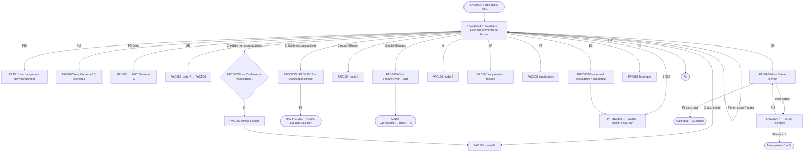

# FAC080S — Gestion des factures (liste, options, copie, avoirs) et FAC080CA (CA facturé)

> *Source :* `FAC080S.rpgle` (4 338 lignes, NP11) — *Type :* RPGLE format fixe + SQL embarqué (bnddir `AXISRV`, `/COPY qilerpg,axiprotos`)
> *DSPF associé :* `FAC080FM` — *CL d'appel :* `FAC080C.clp`
> *Programme rattaché :* `FAC080CA.rpgle` (826 lignes) + DSPF `FAC080CF` — consultation du CA facturé (touche F16)
> *Fichiers décrits :* `FAC080.pf` (en-tête facture), `FAC081.pf` (texte en pied), `FAC080L1` à `FAC080L4`
> *Date d'analyse :* 2026-10-31 — *Auteurs d'origine :* FZ janvier 1998, SC mai 2001, YB décembre 2010 ; FAC080CA : Sophie Coclet, décembre 2002

## Synopsis & objectif

FAC080S est **l'écran d'accueil de la facturation manuelle** : une liste des factures de la société (une ligne par **élément** de facture), consultable selon trois vues (par facture, par client donneur d'ordre ou facturé, par dossier), filtrable par année, profil de saisie, client ou dossier, et limitée par défaut aux factures « en cours » (éléments non édités).

Depuis cette liste, l'utilisateur lance toutes les actions sur une facture : création (F6, via FAC085 puis FAC150), ajout d'un élément, modification, suppression d'un élément ou de la facture, visualisation, édition définitive, brouillon, envoi par e-mail, historique, **copie** (duplication) et **saisie d'avoir** (total ou partiel, par BL).

FAC080S ne saisit pas les lignes de facture : il délègue à **FAC150** (saisie détaillée) et **FAC085** (choix de la clé de facturation). En revanche, il **écrit lui-même** dans les tables de facturation dans trois cas : la modification limitée d'une facture déjà éditée et comptabilisée, la copie d'une facture multi-éléments et la création d'un avoir (total ou partiel).

**FAC080CA** (F16) affiche le chiffre d'affaires HT facturé mois par mois sur trois exercices, avec ou sans port, cumulé ou non, éventuellement limité à une enseigne.

## Contexte d'appel

- **Appelé par** : `FAC080C` (CL), lui-même appelé par les menus de facturation et par `TGFACTURE.clp` (job de groupe sur touche Attention, PAR1/PAR2 lus dans la *GDA).
- `FAC080C` récupère le profil du travail (`RTVJOBA USER`) et le place en position 191-200 de PAR1, puis appelle `FAC080S` et fait un `RCLRSC` (FAC080C.clp l. 28-36).
- **Paramètres** : `PAR1` (256 c.) et `PAR2` (256 c.).

| Zone PAR1 | Position | Rôle |
| --- | --- | --- |
| PSOC | 1-4 | Société |
| PNFAC, PNANNE/PNMOIS/PNJOUR, PNUMT | 5-18 | Facture, date, élément (passés à FAC150 / FAC085 / FAC070) |
| PCODA | 19 | Mode transmis à FAC150 / FAC085 : `C` création, `A` ajout d'élément, `M` modification, `D` duplication, `S` suppression |
| PNGEN / PNCLI (PNCLIA) | 22-34 | Si renseigné à l'appel : ouverture directe en vue client, toutes années (l. 943-951) |
| PNDOSS, PNCLEF, PNBL, PNUMBL, PPOS, PCOTAR | — | Transmis à FAC150 |
| PVENTE, PCA | 50-67 | Totaux retournés par FAC150 |
| PROFIL | 191-200 | Profil utilisateur (posé par FAC080C) |
| APPEL | 211 | `F` = appel depuis FAC080S (vers FAC085) |
| PENSEI | 212 | Enseigne courante (utilisée par FAC080CA) |
| PCPGEN | 213-218 | Compte général client par défaut (zone « Client » de l'écran) |
| PAUTO1…PAUTO8 | 222-237 | Autorisations PRT000P1 AOPT01-08 (`**` = interdit) : 2 = création, 3 = modification, 4 = suppression |
| RETLST | 255 | Code retour des programmes appelés : `0` validé, `1` F12, `3` F3 |

- **Retour** : aucun résultat métier ; F3 met fin au programme.

## Règles métier

**Liste des factures**

- **R1.** La liste affiche une ligne par **élément de facture** (FAC090 joint à FAC080), et non une ligne par facture ; la colonne « Pls » indique si la facture a plusieurs éléments (`FDPLEL > 1`) (l. 3289-3293).
- **R2.** Trois vues (F11 les fait tourner) : par **facture** (vue 0), par **client** (vue 1) et par **dossier** (vue 2). En vue client, F13 bascule entre client **donneur d'ordre** (FEGEND/FECLID) et client **facturé** (FDGENF/FDCLIF) (l. 1092-1158). Les vues client et dossier sont triées par date décroissante (clés `DESCEND` des logiques FAC090L9, LB, LC, LE, LF, LG).
- **R3.** Par défaut, seules les factures **en cours** sont listées : éléments dont `FEEDT <> 'O'` (non édités), logiques FAC090L9 / LA / LB / LF ; F14 bascule vers **toutes les factures** (FAC090LC / LD / LE / LG) (l. 1160-1219, 2477-2540).
- **R4.** Filtre « Sélection de toutes les factures » : `O` = toutes années, `N` = année saisie sur 2 chiffres (pivot : moins de 34 → 20xx, sinon 19xx) ; l'année filtrée est celle de la facture (FEANNE), ou FDANNE en vue client facturé (l. 1281-1283, 2443-2452, 2738-2751).
- **R5.** Filtre par **profil de saisie** : le profil doit exister (AI00F, message PRF0001) ; seules les factures dont `FDPROF` = ce profil sont affichées (l. 1285-1288, 2981-2985).
- **R6.** Positionnement : saisir un n° de facture (« A partir de ») passe en vue facture ; un client passe en vue client ; un dossier passe en vue dossier (l. 1290-1375).
- **R7.** Colonnes : client et nom abrégé (8 c.), n° et date de facture, plusieurs éléments O/N, dossier/clé, **référence de commande du dossier** (AB001.CCREFC, pas FDREF), date de commande (FDCNNE/FDCOIS/FDCOUR), position, quantité facturée (FEQTE), désignation du dossier (CCDES1) ; les avoirs sont en surbrillance (l. 3251-3347).
- **R8.** **Position** affichée selon `FDEDIT` : `A` « Attente », `E` « Edité » ou « Edt+Cpt » si une date de comptabilisation existe (FDCODA/M/J), `O` « A Editer », `S` « Supprimé » (l. 3327-3340).
- **R9.** Pagination manuelle par pages de 10 éléments (MIN 10 / MAX 11, ROLLUP / ROLLDOWN), avec gestion de clés basse et haute par vue et par présence d'un filtre d'année (l. 931-932, 2441-3353).

**Droits**

- **R10.** Autorisations PRT000P1 (via PAR1) : création (F6, `AE`) interdite si PAUTO2 = `**` ; modification et copie (`2`, `3`) interdites si PAUTO3 = `**` ; suppression d'élément ou de facture (`4`, `SF`) interdites si PAUTO4 = `**` ; message « Non autorisé à cette option » (l. 1040, 1434, 1777, 1889, 2099, 2176).
- **R11.** Restriction par représentant : si le représentant lié au profil (B000L2, clé société + profil) a `ILIMIT = 'O'`, l'utilisateur n'agit que sur les factures de **son** représentant (FDREP) ; un responsable (`ISTAT2 = 'MAN'`) agit aussi sur les factures des représentants de son équipe (`ISTAT1`, B000L3). Sinon : « Vous n'avez pas accès à ce dossier » (l. 1383-1398). La liste, elle, n'est pas filtrée.

**Options sur une ligne** (codes acceptés : 2, 3, 4, 6, SF, VF, AE, HI, EE, EB, SA ; tout autre code → PRX0007, l. 1400-1428)

- **R12.** `2` **Modifier** :
  - facture non éditée (`FDEDIT <> 'E'`) → FAC150 en mode `M` (l. 1715-1740) ;
  - facture éditée mais **non comptabilisée** (`FDCOMP <> 'O'`) → fenêtre FAC080W4 « Cette facture est déjà éditée, confirmez-vous sa modification ? » ; sur `O`, **FAC166** remet la facture « à éditer », puis FAC150 en mode `M` (l. 1646-1710) ;
  - facture éditée **et comptabilisée** (`FDCOMP = 'O'`) → fenêtre FAC080W / FAC080C2 de **modification limitée** (R13) (l. 1458-1645).
- **R13.** Modification limitée d'une facture comptabilisée : seuls sont modifiables le client facturé, l'adresse d'envoi (forme juridique, nom, 2 lignes, CP, ville), le pays, le représentant, le mode de règlement, l'option **« Exclure du CA »** et la date d'échéance ; et, par élément, le détail BL (O/N), le taux de commission et l'origine technique ; par article de l'historique (FAC072), le taux de commission. Le client facturé n'est saisissable que si `FDCOMP = 'N'` (indicateur 14, donc en pratique protégé ici). Contrôles : client facturé (AA0003), pays (table `PY`), représentant (B000F), mode de règlement (table `RG`), détail BL `O`/`N` (GEN0046) (l. 1612-1642, 3661-3678).
- **R14.** À la validation (F9) de la modification limitée : mise à jour de FAC080 (client facturé, adresse, pays, représentant, règlement, échéance, **FDTAGR = exclusion du CA**), de FAC090 (FEDTB, FETXC, FEORTE), de l'historique commercial **FAC070** (client facturé, représentant, origine, taux de commission, tag ; montant de commission recalculé `HFMTRP = HFTTHT × HFTXRP / 100` si nature de CA 1 ou 4) et des taux de commission de **FAC072** (l. 2370-2437).
- **R15.** `3` **Copier** : facture mono-élément → FAC150 en mode `D` (duplication) (l. 1790-1816) ; facture **multi-éléments** → fenêtre FAC080W3 (facture ou avoir, date) puis copie directe (R16) (l. 1818-1880).
- **R16.** Copie multi-éléments (SPMULT) : date valide (PRTDAT, DAT0001) et dans l'un des deux exercices ouverts (`SPED1-SPEF1` ou `SPED2-SPEF2` d'AA0007, FAC0025) ; numéro **définitif** attribué par `getfacture(société, enseigne, année, mois, 'D')` (mois = 0 si numérotation annuelle `PTYPEN = 1`, mois si mensuelle `PTYPEN = 2`) ; si échec : FAC0059. Écritures : FAC080 (statut `O` à éditer, indicateurs de comptabilisation, journaux, traite, édition, brouillon, règlement et envoi remis à zéro), tous les FAC090 (FEEDT = `N`), toutes les lignes FAC100 **sans lien BL** (FGLBL = `N`, FGBL/FGBLEL/FGBLLG = 0), FAC081 et FAC105. Message « Vous venez de créer la facture N° … » (l. 3682-3807).
- **R17.** `4` **Supprimer un élément** : uniquement si l'élément n'est pas édité (`FEEDT = 'N'`, sinon FAC0016) → FAC150 en mode `S` ; point d'entrée PPOS = `4` si l'élément a un code tarif client et n'est pas de type 3, `5` si type d'élément 3, `6` sinon (l. 1886-1953).
- **R18.** `SF` **Supprimer la facture** : même condition FEEDT = `N` → **FAC160** (« suppression / réédition d'une facture ») (l. 2098-2145).
- **R19.** `VF` **Visualiser** → **FAC525** (aperçu, type d'imprimé 5) (l. 2147-2173).
- **R20.** `6` **Éditer** : refusé si la facture est en attente (`A`) ou supprimée (`S`) (« Edition impossible ») ; sinon soumission via **PRTBCH00** du travail **FAC199** en mode définitif (P3TYPE blanc), formulaire `FAC010.PFORM`, condensé `PEDIC` (l. 1956-1988).
- **R21.** `EB` **Brouillon** : soumission de FAC199 en mode `B`, **sans contrôle de statut** (l. 1991-2017).
- **R22.** `EE` **Envoi par e-mail** : uniquement si la facture est éditée (`FDEDIT = 'E'`, sinon FAC0017). Destinataire proposé : l'e-mail du premier contact du client (donneur d'ordre ou facturé selon la vue) marqué « défaut envoi facture » (`PRT051F.CNFACD = 'O'`) ; destinataire et expéditeur obligatoires (GEN0001), F4 sur les contacts (PRT051R2) ou les représentants (B000R2). Soumission de FAC199 avec P3EXP / P3DES / P3OPT = `EE`, P3TYRT = `I` (l. 2019-2095).
- **R23.** `HI` **Historique** → **FAC070** (mise à jour de l'historique de facturation) (l. 1744-1766).
- **R24.** `AE` **Ajouter un élément** : élément non édité (FEEDT = `N`) → **FAC085** en mode `A` avec la facture (l. 2175-2217).
- **R25.** F6 **Créer** → FAC085 en mode `C` ; au retour `0`, la liste est rechargée ; `3` termine aussi FAC080S (l. 1038-1090).

**Saisie d'avoir (option `SA`)**

- **R26.** Possible seulement sur une **facture** (`FDTYPE = 'F'`, sinon FAC0070) **déjà éditée** : refus si `FDEDIT` = `O` ou `A` (FAC0069) (l. 2221-2234).
- **R27.** Fenêtre FAC080W6 : date de l'avoir (défaut : date du jour), n° de facture et dossier affichés, « Avoir total » O/N. Contrôles : date valide (DAT0001), dans un exercice ouvert (FAC0025) ; pour un avoir **partiel**, l'élément doit porter un **dossier** (FAC0071) (l. 3811-3853).
- **R28.** **Avoir total** (F9 avec « Avoir total » = O, SPCRETOT) : numéro définitif `getfacture` (FAC0059 si échec) ; nouvel en-tête FAC080 copié de la facture avec `FDTYPE = 'A'`, **facture d'origine** (FDFACO / FDFACA), statut `O` à éditer, **tous les montants d'en-tête à zéro** (recalculés à l'édition), comptabilisation, journaux et envoi remis à zéro ; copie de tous les FAC090, FAC100 (lignes **identiques, avec leurs liens BL**), FAC081 et FAC105 à la date de l'avoir (l. 3960-4102).
- **R29.** Avoir total — **libération des BL** : chaque BL de la facture d'origine (EXP010L7) est **dé-facturé** (HNOFAC, date et élément de facture à 0, `HBLFAC = 'N'`), et ses éléments à facturer en plus (EXP011) rattachés à la facture repassent non facturés (`HPFACT` à blanc). Les BL redeviennent donc facturables (refacturation manuelle ou automatique) (l. 4104-4129).
- **R30.** **Avoir partiel** (« Avoir total » = N) : liste (FAC080C7) des **éléments de BL** facturés sur l'élément de facture, avec date d'expédition, raison sociale et CP, et sous chaque BL ses articles et quantités (lecture SQL EXP009 + EXP010 + EXP015, l. 3869-3956). L'utilisateur coche (`1`) un élément de BL ; F9 crée l'avoir (SPCREPAR) : en-tête FAC080 comme R28 mais avec `FDPLEL = 1`, l'élément FAC090 avec CA et vente à zéro, **seules les lignes FAC100 de ce BL** (FAC100L2), FAC081, FAC105 ; l'élément de BL est dé-facturé dans EXP010 (pas EXP011) (l. 4135-4328).

## Flow des écrans

### Détail par écran

**FAC080C1 + sous-fichier FAC08001 — Gestion des factures**
- Rôle : critères (« A partir de » facture, client, dossier, toutes les factures O/N ou année, profil), liste des éléments de facture.
- Options : 2 modifier élément, 4 supprimer élément, SF supprimer facture, AE ajout élément, VF visualisation, 6 éditer, 3 copier, EB brouillon, EE e-mail ; HI et SA sont acceptés mais ne figurent pas dans la légende de l'écran.
- Touches : F1 aide, F3 fin, F4 recherche (client AA0003R, dossier AB001R / AB001R2, profil AI000R2), F5 réafficher, F6 créer, F10 détail (SFLDROP), F11 vue, F12 retour, F13 DO / facturé, F14 toutes / en cours, F15 environnement, F16 CA, F24 autres touches.

**FAC080W / FAC080C2 (+ FAC08002, pied FAC08032) — Modification d'une facture comptabilisée** : en-tête modifiable (R13) et sous-fichier des éléments et articles de l'historique (détail BL, % commission, origine). F4 recherche (client facturé, pays, représentant, mode de règlement), F9 valider, F12 annuler.

**FAC080W3 — Copie de facture multi-éléments** : F/A et date de facture.

**FAC080W4 — Confirmation de modification d'une facture éditée** (O/N).

**FAC080W5 — Envoi de facture par e-mail** : destinataire, expéditeur ; F4 recherche.

**FAC080W6 — Saisie d'avoir** : date, n° de facture, dossier, avoir total O/N ; F9 valider, F12 annuler.

**FAC080C7 (+ FAC08007, pied FAC08037) — Avoir partiel** : BL n°/élément, date d'expédition, raison sociale, CP ; lignes article protégées ; option `1` ; F9 valider, F12 retour.

**FAC080CF / FAC080C1 + FAC08001 (FAC080CA)** — CA facturé hors taxes, 12 mois × 3 exercices ; F11 avec / sans port, F14 avec / sans cumul, F12 retour.

## Contrôles & validations par écran

### FAC080C1 — Liste

| Champ | Type de contrôle | Condition | Message | Règle |
| --- | --- | --- | --- | --- |
| ESEL | Valeur | O ou N | GEN0001 | R4 |
| EPROF | Existence | AI00F | PRF0001 | R5 |
| EGEN1 / ECLI1 | Recherche | AA0003R | GEN0002 | R6 |
| EDOSS1 / EDCLE1 | Recherche | AB001R | GEN0002 | R6 |
| OPTION | Valeur | 2, 3, 4, 6, SF, VF, AE, HI, EE, EB, SA | PRX0007 | — |
| OPTION 2, 3, 4, SF, AE, F6 | Autorisation PRT000P1 | PAUTO2/3/4 ≠ `**` | « Non autorisé à cette option » | R10 |
| OPTION (sauf 6, EB, SA) | Représentant du profil | B000F ILIMIT / ISTAT | « Vous n'avez pas accès à ce dossier » | R11 |
| OPTION 4, SF, AE | Élément non édité | FEEDT = N | FAC0016 | R17, R18, R24 |
| OPTION 6 | Statut | FDEDIT ≠ A, S | « Edition impossible » | R20 |
| OPTION EE | Statut | FDEDIT = E | FAC0017 | R22 |
| OPTION SA | Type et statut | FDTYPE = F ; FDEDIT ≠ O, A | FAC0070, FAC0069 | R26 |
| OPTION 2 | Facture introuvable | FAC080 | FAC0061 | R12 |

### FAC080C2 — Modification limitée

| Champ | Type de contrôle | Condition | Message | Règle |
| --- | --- | --- | --- | --- |
| WGENF / WCLIF | Existence | AA0003 | GEN0002 | R13 |
| WPAYS | Table PY | AA00081 | PAY0001 | R13 |
| WREPR | Existence | B000F | REP0001 | R13 |
| WMODRG | Table RG | AA00081 | CPT0004 | R13 |
| WEXCA | Valeur | O / N | DDS | R13 |
| WEDTB | Valeur | O / N | GEN0046 | R13 |

### FAC080W3 / FAC080W6 — Copie et avoir

| Champ | Type de contrôle | Condition | Message | Règle |
| --- | --- | --- | --- | --- |
| EFACAV | Valeur | F / A | DDS | R16 |
| EDATFA / WDATAV | Date valide | PRTDAT | DAT0001 | R16, R27 |
| EDATFA / WDATAV | Exercice ouvert | SPED1-SPEF1 ou SPED2-SPEF2 | FAC0025 | R16, R27 |
| Numérotation | getfacture ≠ -1 | FAC010 / compteurs | FAC0059 | R16, R28 |
| WTOTAV | Dossier requis pour un avoir partiel | WNODOS ≠ 0 | FAC0071 | R27 |

### FAC080W5 — E-mail

| Champ | Type de contrôle | Condition | Message | Règle |
| --- | --- | --- | --- | --- |
| EDEST | Obligatoire | — | GEN0001 | R22 |
| EEXP | Obligatoire | — | GEN0001 | R22 |

Les libellés des messages sont dans `PRTMSG` (*MSGF non exporté).

## Tables mises à jour

| Table | Opération | Condition | Champs touchés | Règle |
| --- | --- | --- | --- | --- |
| FAC080 (en-tête) | UPDATE | Modification limitée (facture comptabilisée) | FDGENF, FDCLIF, adresse, FDPAYS, FDREP, FDRGLT, FDECHA/M/J, FDTAGR | R14 |
| FAC080 | WRITE | Copie multi-éléments, avoir total, avoir partiel | En-tête complet (nouveau n°, date, type, statut O, remises à zéro) ; avoirs : FDFACO, FDFACA, montants à 0 | R16, R28, R30 |
| FAC090 (élément) | UPDATE | Modification limitée | FEDTB, FETXC, FEORTE | R14 |
| FAC090 | WRITE | Copie, avoirs | Élément copié, FEEDT = N ; avoir partiel : FECA, FEVEN, FECAA, FEVENA = 0 | R16, R28, R30 |
| FAC100 (lignes) | WRITE | Copie (liens BL effacés), avoir total (lignes identiques), avoir partiel (lignes du BL) | Ligne complète | R16, R28, R30 |
| FAC081 (texte en pied) | WRITE | Copie, avoirs | Texte complet | R16, R28, R30 |
| FAC105 (textes de l'élément) | WRITE | Copie, avoirs | Texte complet | R16, R28, R30 |
| FAC070 (historique commercial) | UPDATE (FAC070L2) | Modification limitée | HFGENF, HFCLIF, HFREPR, HFORTC, HFTXRP, HFTAG, HFMTRP | R14 |
| FAC072 (historique par article) | UPDATE (FAC072L2) | Modification limitée | HNTXRP | R14 |
| EXP010 (élément de BL) | UPDATE (EXP010L7) | Avoir total (tous les BL de la facture) ; avoir partiel (BL choisi) | HNOFAC, HDAFAA/M/J, HNOELT = 0, HBLFAC = N | R29, R30 |
| EXP011 (à facturer en plus) | UPDATE | Avoir total, si HPFACT = O et HPNFAC = facture | HPFACT = blanc | R29 |
| FAC040 / PRT320F (compteurs) | via `getfacture` mode `D` | Copie, avoirs | Dernier numéro | R16, R28 |

FAC080CA ne met rien à jour.

## Tables consultées (lecture seule)

- **AA0007** société (exercices SPED/SPEF, enseigne SOP03), **FAC010** paramètres de facturation (PTYPEN, PFORM, PEDIC), **AI00F** profils, **B000F / B000L2 / B000L3** représentants (ILIMIT, ISTAT1, ISTAT2).
- **FAC090L9, LA, LB, LC, LD, LE, LF, LG** : logiques joints FAC090 + FAC080 (listes par vue, en cours / toutes).
- **AB001** dossiers (CCDES1, CCREFC), **AA0003** clients, **PRT051F** contacts (CNFACD, CNEMAI), **AA00081** tables (RG, PY), **FAC072L1** historique par article.
- **EXP009, EXP010, EXP015** (SQL) : BL facturés sur l'élément, pour l'avoir partiel.
- FAC080CA : **AA0007** (limites d'exercice SLED1/SLEF1/SLED2/SLEF2), **PRT320L1** enseignes, **FAC080** (SQL).

## Dépendances

### Programmes appelés
- **FAC085** (création, ajout d'élément), **FAC150** (modification, duplication, suppression d'élément), **FAC160** (suppression de facture), **FAC166** (remise d'une facture éditée à l'état « à éditer »), **FAC525** (visualisation), **FAC070** (historique), **FAC080CA** (CA facturé).
- **PRTBCH00** avec P3JOB = `FAC199` : édition définitive, brouillon, e-mail ([FAC199](FAC199.md)).
- **`getfacture`** (programme de service AXISRV) : numéro définitif (copie, avoirs).
- **PRTRTVUS** (profil), **PRTDAT** (dates), **PRTAID** (aide), **PRT810** (environnement).
- Recherches : **AA0003R**, **AB001R**, **AB001R2**, **AI000R2**, **AA0008R**, **B000R**, **B000R2**, **PRT051R2**.

### Copybooks / includes
- `/COPY qilerpg,axiprotos` : prototypes AXISRV (dont `getfacture`).

### Fichiers décrits

| Fichier | Rôle | Clé / sélection |
| --- | --- | --- |
| FAC080 | En-tête facture (UNIQUE) | RSOC, RNFAC, FDANNE, FDMOIS, FDJOUR |
| FAC081 | Texte en pied (UNIQUE), 40 c. par ligne | RSOC, RNFAC, FDANNE, FDMOIS, FDJOUR, FDTLIG |
| FAC080L1 | Factures non réglées par client DO | RSOC, FDGEND, FDCLID, RNFAC, date ; sélection FDTAGR = blanc et FDTYPE = F |
| FAC080L2 | Factures par client DO | même clé ; sélection FDTYPE = F |
| FAC080L3 | Factures par date | RSOC, FDANNE, FDMOIS, FDJOUR, RNFAC |
| FAC080L4 | Factures par année et numéro (DL, février 2020) | RSOC, FDANNE, RNFAC (recherche de la facture d'origine d'un avoir, cf. FAC150) |

Zones notables de FAC080 : FDTYPE (F/A), FDEDIT (`A` à contrôler, `E` éditée, `O` à éditer, `S` supprimée), FDCOMP (comptabilisée O/N), FDEDT / FDBROU (édition définitive / brouillon), FDTAGR (« facture réglée » selon la DDS, **utilisée comme « Exclure du CA »** par FAC080S et FAC080CA), montants HT / port taxable / port exonéré / escompte / TVA en monnaie société et « autre monnaie », FDCDEV / FDCOURD (devise et cours), FDFACO / FDFACA (facture d'origine d'un avoir), FDRFAD / FDRFAF (période d'avoir), zones d'envoi (FDTAGE, FDNONE, FDDATEE, FDHEURE, FDMANAU, FDMETHE, FDTYPEE) et zones **Factur-X** (FDIDFACTX, FDSTAT, FDMENTIONR, FDFACOMPTE, FDFACRECTI, FDBIENSERV, FDPDPRED, FDFACSTAT).

### Sources disponibles, non rétro-documentées (vérifié le 2026-10-31)
- `FAC160`, `FAC165`, `FAC166`, `FAC525`, `FAC070`, `FAC090` (programme), `PRT810`, `PRTBCH00` : source dans NP11.

## Dépendances manquantes
- `PRTMSG` (*MSGF) : libellés des messages non exportés.

## FAC080CA — CA facturé des trois derniers exercices

- **Appel** : F16 depuis FAC080S (PAR1 sauvegardé et restauré autour de l'appel, l. 1246-1256). Paramètres utilisés : PSOC, PENSEI.
- **R-CA1.** Les trois colonnes sont l'exercice le plus récent (ANNEE0), l'autre exercice ouvert (ANNEE1) et l'exercice qui le précède (ANNEE2 = ANNEE1 − 1), déterminés par les limites `SLED1/SLEF1` et `SLED2/SLEF2` d'AA0007 (AAAAMM) ; les lignes sont les 12 mois dans l'ordre de l'exercice le plus récent (FAC080CA l. 258-293).
- **R-CA2.** CA d'une facture = `FDMTN − FDMES` (HT net d'escompte) ; « avec port » = `FDMTN + FDPOT + FDPOE − FDMES` (l. 343, 357).
- **R-CA3.** Seules comptent les pièces **éditées** (`FDEDIT = 'E'`) et non exclues du CA (`FDTAGR <> 'O'`) ; les factures (`F`) s'ajoutent, les avoirs (`A`) se soustraient (l. 340-600).
- **R-CA4.** Si une enseigne est transmise (PENSEI), seules ses factures sont comptées (`FDENS`) (l. 319-329, 355-366).
- **R-CA5.** Un mois est rangé dans la colonne de l'exercice qui contient sa période AAAAMM ; tout le reste de la plage interrogée va dans la troisième colonne (l. 407-445).
- **R-CA6.** F14 cumul : cumul progressif des mois ; pour l'exercice en cours, le cumul est mis à 0 après le mois courant (l. 626-644).
- **R-CA7.** F11 avec / sans port ; totaux annuels en bas (l. 761-802).

## Anomalies relevées (à ne pas reproduire)

- **A1. Avoir partiel limité au premier BL coché** : SPCREPAR sort (`LEAVESR`, l. 4325) après avoir traité le premier élément de BL sélectionné ; les autres cases cochées sont ignorées, sans message. Si aucune case n'est cochée, la fenêtre se ferme sans avoir créé quoi que ce soit.
- **A2. Enseigne de numérotation indéterminée** : `getfacture(PSOC:FDENS:…)` (l. 3708, 3980, 4175) utilise `FDENS` resté dans le tampon de la **dernière facture lue lors du chargement de la page** (CHAIN l. 3275), pas celle de la facture sélectionnée. Avec une numérotation par enseigne (`PTYPEN = 3`), la copie ou l'avoir peut prendre un numéro dans le compteur d'une autre enseigne ; de plus le mois n'est géré que pour `PTYPEN` 1 et 2.
- **A3. Copies et avoirs non audités** : contrairement à FAC150 (EVE400), FAC080S n'écrit aucune trace d'audit pour la copie, l'avoir total, l'avoir partiel ou la modification d'une facture comptabilisée.
- **A4. Modification d'une facture comptabilisée sans écriture comptable** : client facturé, mode de règlement, échéance et représentant sont modifiés dans FAC080 / FAC070 après comptabilisation, sans régularisation comptable ni historique (R13, R14).
- **A5. Zones Factur-X et d'envoi recopiées** : la copie et les avoirs ne remettent à zéro ni `FDIDFACTX` / `FDSTAT` (identifiant et statut Factur-X), ni `FDNONE`, `FDMANAU`, `FDMETHE`, `FDTYPEE`, ni `FDFACRECTI`, `FDFACOMPTE` ; la copie conserve aussi `FDFACO` / `FDFACA` / période d'avoir, `FDPROF` et `FDINAT` de la facture d'origine (pas l'utilisateur courant).
- **A6. Avoir partiel : textes et port** : tous les textes FAC105 de la facture (tous éléments) sont copiés alors qu'un seul élément l'est ; les lignes sans lien BL (port, remise, texte) ne sont pas reprises ; EXP011 n'est pas libéré.
- **A7. Avoir total : montants d'élément conservés** (FECA, FEVEN non remis à zéro, à la différence de l'avoir partiel) et lignes FAC100 recopiées avec leurs liens BL alors que ces BL sont dé-facturés.
- **A8. Saisie d'avoir sur facture supprimée** : le contrôle refuse `FDEDIT` = `O` et `A`, mais accepte `S` (supprimée) en plus de `E`.
- **A9. Contrôles d'accès incomplets** : 6, EB et SA ne vérifient pas la restriction par représentant ; SA ne vérifie aucune autorisation PRT000P1 ; l'indicateur d'accès 07 n'est pas réinitialisé si le profil n'a pas de représentant (valeur de l'option précédente conservée, l. 1384-1398).
- **A10. Pivots d'année incohérents** : 34 pour la liste et la numérotation (l. 1297, 3693), 50 pour le contrôle d'exercice de la copie (l. 1845), « 20 » forcé pour les avoirs (l. 3829, 3968).
- **A11. Champ détourné** : `FDTAGR` (« facture réglée » dans la DDS, sélection de FAC080L1) sert d'« exclusion du CA ».
- **A12. Recherche du destinataire e-mail** : F4 utilise `RGEN` / `RCLI`, zones cachées jamais alimentées par le chargement de la liste (valeur du dernier client lu) *(à vérifier)*.
- **A13. Copie multi-éléments** : l'indicateur FAC0066 (« contrôle du prochain n° ») est commenté ; les écritures ne sont pas dans une transaction (une erreur d'écriture laisse une facture partielle).

## Concepts métier signalés au glossaire

Élément de facture (unité de la liste), Factures « en cours » (FEEDT ≠ O), Position de facture (Attente / Edité / Edt+Cpt / A Editer / Supprimé), Exclusion du CA (FDTAGR), Facture comptabilisée (FDCOMP), Avoir total / avoir partiel par BL, Libération des BL par avoir, Copie de facture multi-éléments, Contact « défaut envoi facture » (PRT051F.CNFACD), Restriction d'accès par représentant (B000F.ILIMIT, ISTAT2 = MAN), CA facturé net d'escompte.

## Notes & points d'attention pour la migration

- **Écran cible** : une liste de factures (pas d'éléments) avec recherche explicite (rien chargé à l'ouverture), filtres client / dossier / année / statut / profil, sans pagination (garde-fou), et un détail de facture listant ses éléments. Les trois vues et les clés basses / hautes disparaissent.
- **Avoirs** : à reconstruire comme un **service** unique « créer un avoir depuis une facture » (total ou partiel par lignes ou par BL), qui : numérote à la validation, référence la facture d'origine (obligatoire pour la facture électronique), remet à zéro les zones d'envoi et Factur-X, et décide **explicitement** si les BL sont libérés pour refacturation (aujourd'hui : oui en total, oui pour le BL choisi en partiel). Décision métier à faire valider.
- **Copie** : même service de duplication que FAC150 mode `D`, en remettant à zéro statut, liens BL, zones d'envoi, Factur-X et en prenant l'utilisateur courant.
- **Facture comptabilisée** : la modification limitée doit être soit interdite (avoir + nouvelle facture), soit tracée et répercutée en comptabilité ; à arbitrer avec le métier.
- **Droits** : appliquer les autorisations Création / Modification / Suppression à toutes les options (y compris avoir) et la restriction par représentant à la **liste** elle-même.
- **Édition / e-mail** : remplacer PRTBCH00 + FAC199 par le service documentaire (PDF généré une fois, stocké, réutilisé pour l'e-mail) ; le destinataire par défaut reste le contact « défaut envoi facture ».
- **CA facturé (FAC080CA)** : simple requête agrégée (factures − avoirs éditées, hors exclues), réutilisable pour un tableau de bord ; garder la règle « net d'escompte ».
- **Transactions** : copie et avoirs écrivent 5 à 7 tables sans contrôle de validation ; en cible, une transaction unique.
