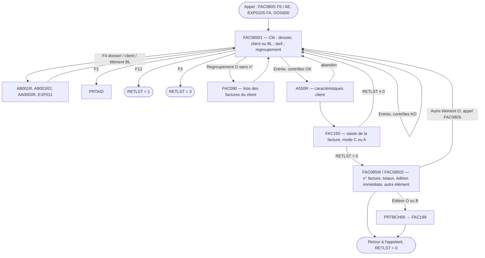

# FAC085 — Choix de la clé de facturation (dossier, client ou BL) avant la saisie de facture

> *Source :* `FAC085.rpgle` (933 lignes, NP11) — *Type :* RPGLE format fixe
> *DSPF associé :* `FAC085FM`
> *Date d'analyse :* 2026-10-31 — *Auteur d'origine :* FZ (Farad Zatar), juin 1993 / janvier 1998

## Synopsis & objectif

FAC085 est l'**écran d'entrée de la saisie d'une facture manuelle**. Avant d'ouvrir la saisie détaillée (FAC150), l'utilisateur indique **sur quoi** il facture : un **dossier**, un **client** ou un **bon de livraison**. Il précise s'il applique un **tarif client** et s'il veut **regrouper** cet élément sur une facture existante (ajout d'élément) plutôt que de créer une nouvelle facture.

FAC085 contrôle ces choix (existence, BL non facturé et facturable, tarif existant, facture de regroupement non éditée et du même client), affiche les caractéristiques commerciales du client (A550R), puis appelle FAC150. Au retour, une petite fenêtre affiche le numéro de facture et ses totaux et propose l'**édition immédiate** (définitive ou brouillon) et l'**ajout d'un autre élément** sur la même facture.

FAC085 **n'écrit dans aucune table** : toutes les écritures sont faites par FAC150 (et par FAC199 pour l'édition).

## Contexte d'appel

| Appelant | Situation | Paramètres posés |
| --- | --- | --- |
| `FAC080S` F6 (l. 1038-1090) | Création d'une facture depuis la liste | PCODA = `C`, APPEL = `F`, facture et client à 0 |
| `FAC080S` option `AE` (l. 2175-2217) | Ajout d'un élément à une facture | PCODA = `A`, APPEL = `F`, PNFAC + date + élément |
| `EXP010S` option `FA` (sous-routine FACTUR, l. ~2136 et 4043-4070) | **Facturer un BL depuis la gestion des expéditions** | APPEL = `O`, PPOS = `3`, PNBL / PNUMBL = BL et élément, PNDOSS / PNCLEF = dossier du BL, PENSEI = enseigne du BL, PCPGEN = compte général du client. EXP010S refuse au préalable les BL de retour (`HETABL = 'R'`) et vérifie l'autorisation de création (`AOPT02`) |
| `EXP010` (l. ~7290-7310) | Même appel depuis l'ancien programme d'expédition | idem |
| `DOS600` (l. 3440-3460) | Facturer un dossier depuis le menu du dossier | APPEL = `O`, PPOS = `1`, PNDOSS / PNCLEF = dossier |

**Paramètres** : `PAR1` et `PAR2` (256 c. chacun), même structure que FAC150.

| Zone PAR1 | Entrée | Sortie |
| --- | --- | --- |
| PSOC (1-4) | Société | — |
| PNFAC (5-10), PNANNE / PNMOIS / PNJOUR (11-16) | Facture et date en ajout d'élément | Facture créée ou complétée (retour de FAC150) |
| PNUMT (17-18) | Élément | — |
| PCODA (19) | `A` = ouvrir en mode ajout (regroupement pré-rempli) | `C` ou `A` transmis à FAC150 |
| PTAR (20), PCOTAR (48-49) | — | Tarif client O/N et code tarif |
| PNELT (21) | — | Regroupement sur une facture O/N |
| PNGEN / PNCLI (22-34) | Client d'origine (contrôle du tarif) | Client facturé |
| PNDOSS / PNCLEF (35-40) | Dossier pré-rempli si PPOS = `1` | Dossier |
| PNBL (41-46), PNUMBL (74-76) | BL pré-rempli si PPOS = `3` | BL et élément |
| PPOS (47) | `1` dossier, `3` BL (pré-remplissage si APPEL = `O`) | Point d'entrée FAC150 : `1` client, `2` dossier, `3` BL |
| PVENTE (50-58), PCA (59-67) | — | Total vente HT, total CA de l'élément (retour de FAC150) |
| PROFIL (191-200) | Profil | Restauré avant l'appel de FAC150 |
| APPEL (211) | `F` depuis FAC080S, `O` depuis EXP010S / DOS600 | — |
| PCPGEN (213-218) | Compte général client par défaut | — |
| RETLST (255) | — | `0` validé, `1` F12, `3` F3 (et `9` reçu de FAC090) |

## Règles métier

**Clé de facturation**

- **R1.** Il faut saisir **une et une seule** clé : dossier, client ou BL (GEN0013 si aucune ou plusieurs) (l. 334-355).
- **R2.** Le **dossier** doit exister (AB001, DOS0001) et ne pas être de type `CCTYPC = '2'` (FAC0065 ; commentaire du source : « erreur si mise en stock ») (l. 359-369). La recherche F4 ne propose que les dossiers de type 1, 3 et 4 (l. 816, 845).
- **R3.** Le **client** doit exister (AA0003, CPT0001) ; son nom est affiché avec sa forme juridique (l. 372-381).
- **R4.** Le **BL** ne doit être ni de sous-traitance (`HETABL = 'S'`) ni divers (`'D'`) (BL00033) (l. 384-392).
- **R5.** Si la société gère des **BL multi-dossiers** (`AA0007.SOP06` = `4` ou `5`) et que le BL a plusieurs éléments sans que l'élément soit précisé, la liste des éléments du BL (programme EXP011) est proposée (l. 393-419, 730-731).
- **R6.** L'élément de BL doit exister (BL00008), **ne pas être déjà facturé** (`HNOFAC = 0`, sinon FAC0019) et être **facturable** (`HFACTU <> 'N'`, sinon FAC0060) (l. 421-434).

**Tarif client**

- **R7.** « Tarif client » vaut `O` ou `N` (GEN0006). Si `O`, le code tarif est obligatoire (GEN0001) ; si `N`, il doit être vide (GEN0012) (l. 438-444).
- **R8.** Le code tarif est recherché dans FAC060 pour le client de la clé (client du dossier AB001, client saisi ou client du BL), sinon pour le client d'origine transmis en paramètre, sinon dans le **tarif général** (client 0) ; introuvable : FAC0013 ; le libellé du tarif est affiché (l. 445-471). *(Voir anomalie A2.)*

**Regroupement sur une facture existante**

- **R9.** « Élément à regrouper sur une seule facture » vaut `O` ou `N` (GEN0006) ; si `N`, aucun n° de facture ne doit être saisi (GEN0012) (l. 473-477).
- **R10.** Si un n° de facture est saisi, la facture doit exister (FAC0020) : par n° + date si la date est connue, sinon **la plus récente portant ce numéro** (l. 479-501).
- **R11.** La facture de regroupement ne doit **pas être éditée** (`FDEDT <> 'N'` → FAC0021) (l. 503).
- **R12.** Pour une clé client ou BL, le client donneur d'ordre de la facture doit être celui de la clé (FAC0023) ; ce contrôle n'existe pas pour une clé dossier (lignes commentées) (l. 505-510).
- **R13.** Regroupement demandé sans n° de facture : la liste des factures du client est proposée (programme **FAC090**) ; abandon dans la liste (`RETLST = '9'`) → FAC0048 (l. 536-553).
- **R14.** Contrôle « le dossier est déjà un élément de cette facture » : boucle sur FAC090 présente mais **désactivée** (message FAC0049 jamais émis) (l. 555-594).

**Passage à la saisie**

- **R15.** Les caractéristiques commerciales du client (A550R, code `   O `) sont affichées avant la saisie ; un abandon (`PRET = '3'`) annule (l. 596-613).
- **R16.** FAC150 est appelé avec : point d'entrée `2` dossier, `1` client ou `3` BL ; mode `C` (nouvelle facture) si pas de regroupement, `A` (ajout d'élément) sinon ; le client facturé, le dossier, le BL et le tarif choisis (l. 513-645).
- **R17.** Après validation dans FAC150 (`RETLST = '0'`), la fenêtre de fin affiche le n° de facture, le **total vente HT** et le **total CA de l'élément** ; « Édition immédiate » est proposée avec la valeur par défaut `EXP005.FEOP01` (option de préparation n° 1 de la société) et « Autre élément sur cette facture » vaut `N` (l. 647-654).
- **R18.** Édition immédiate : `O` = édition **définitive**, `B` = **brouillon**, `N` = aucune ; `O` et `B` soumettent via PRTBCH00 le travail **FAC199** pour cette seule facture (formulaire FAC010.PFORM, condensé PEDIC) (l. 680-691, 752-775).
- **R19.** « Autre élément » = `O` (et appel depuis FAC080S) : retour à l'écran de clé en mode regroupement sur la même facture, sans édition ; depuis EXP010S ou DOS600 (APPEL = `O`), FAC085 se termine toujours après la première facture (l. 685-699).

## Flow des écrans

### Détail par écran

**FAC08501 — Sélection de la clé** : dossier + clé (et libellé), client (général + auxiliaire, et nom), n° de BL + n° d'élément (élément visible seulement en BL multi-dossiers), tarif client O/N + code tarif (et libellé), regroupement O/N + n° de facture. Touches : F1 aide, F3 fin, F4 recherche selon la position du curseur, F12 retour.

**FAC085W / FAC08502 — Fin de saisie** : n° de facture, total vente HT, total CA de l'élément, édition immédiate (O/N/B), autre élément sur cette facture (O/N).

## Contrôles & validations par écran

### FAC08501

| Champ | Type de contrôle | Condition | Message | Règle |
| --- | --- | --- | --- | --- |
| EDOSS / ECLI / ENBL | Exactement une clé | — | GEN0013 | R1 |
| EDOSS / EDCLE | Existence ; type de dossier | AB001 ; CCTYPC ≠ 2 | DOS0001, FAC0065 | R2 |
| EGEN / ECLI | Existence | AA0003 | CPT0001 | R3 |
| ENBL | État du BL | HETABL ≠ S, D | BL00033 | R4 |
| ENBL / ENUMBL | Existence, non facturé, facturable | EXP010L1 ; HNOFAC = 0 ; HFACTU ≠ N | BL00008, FAC0019, FAC0060 | R5, R6 |
| ETRC | Valeur | O / N | GEN0006 | R7 |
| CTRF | Obligatoire si O, interdit si N ; existence | FAC060 (client, client d'origine, général) | GEN0001, GEN0012, FAC0013 | R7, R8 |
| ER1F | Valeur | O / N | GEN0006 | R9 |
| ENUMF | Interdit si pas de regroupement ; existence ; non éditée ; même client | FAC080 | GEN0012, FAC0020, FAC0021, FAC0023 | R9-R12 |
| ENUMF | Abandon de la liste des factures | FAC090 | FAC0048 | R13 |
| (dossier déjà dans la facture) | désactivé | FAC090 | FAC0049 | R14 |
| Recherches F4 | Aucun résultat | — | GEN0002 | — |

### FAC08502

| Champ | Type de contrôle | Condition | Message | Règle |
| --- | --- | --- | --- | --- |
| EDTIM | Valeur | O / N / B | GEN0006 | R18 |
| AUTEF | Valeur | O / N | GEN0006 | R19 |

## Tables mises à jour

Aucune. FAC085 ne fait que des lectures ; les écritures sont faites par **FAC150** (FAC080, FAC090, FAC100, FAC105, FAC081, EXP010, EXP011, AB004, compteurs, audit) et, en cas d'édition immédiate, par **FAC199**.

## Tables consultées (lecture seule)

- **AA0007** société (SOP06 : BL multi-dossiers), **FAC010** paramètres de facturation (PFORM, PEDIC), **EXP005** paramètres d'expédition (FEOP01 : édition immédiate par défaut).
- **AB001** dossiers (CCTYPC, CCDES1, client RGEN / RCLI), **AA0003** clients, **EXP010L1** éléments de BL (HETABL, HNOFAC, HFACTU, client HGENE / HCLIE, dossier HNODOS / HCLEF).
- **FAC080** en-têtes de facture, **FAC090** éléments, **FAC060** tarifs clients.

## Dépendances

### Programmes appelés
- **FAC150** : saisie de la facture ([FAC150](FAC150.md)).
- **FAC090** (programme « Gestion des factures ») : choix d'une facture du client pour le regroupement.
- **A550R** : caractéristiques commerciales du client.
- **EXP011** (programme « Affichage des éléments d'un BL ») : choix de l'élément d'un BL multi-dossiers.
- **PRTBCH00** avec P3JOB = `FAC199` : édition immédiate ([FAC199](FAC199.md)).
- **PRTAID** (aide), recherches **AA0003R**, **AB001R**, **AB001R2**.

### Copybooks / includes
- `/COPY HBP2CVTR` : conversion d'année 2 → 4 chiffres (routine `HBà24Y`).

### Sources disponibles, non rétro-documentées (vérifié le 2026-10-31)
- `FAC090` (programme), `EXP011` (programme), `A550R`, `PRTBCH00` : source dans NP11.

## Dépendances manquantes
- `/COPY HBP2CVTR` : copybook absent de NP11 et ana11s.
- `PRTMSG` (*MSGF) : libellés des messages non exportés.

## Anomalies relevées (à ne pas reproduire)

- **A1. Contrôle de l'état du BL avant le test d'existence** : `HETABL` est testé juste après un `CHAIN(N)` dont le résultat n'est pas vérifié (l. 387-392) ; si le BL n'existe pas, le test porte sur l'enregistrement lu précédemment.
- **A2. Tarif du client d'origine jamais retenu** : après la deuxième recherche FAC060 (indicateur 32), le programme teste l'indicateur 31 de la première (l. 461-462) ; il passe donc toujours au tarif général, et refuse (FAC0013) un tarif qui n'existe que pour le client d'origine.
- **A3. Regroupement sur une facture supprimée** : le contrôle porte sur `FDEDT` (édition définitive O/N), pas sur `FDEDIT` ; une facture `S` (supprimée) ou `A` (à contrôler) non éditée peut recevoir un nouvel élément.
- **A4. Facture de regroupement ambiguë** : sans date, c'est la facture **la plus récente** portant ce numéro qui est prise (SETGT / READPE) ; avec une numérotation annuelle ou mensuelle, le même numéro existe chaque année ou chaque mois.
- **A5. Contrôles désactivés** : même client pour une clé dossier (l. 505-506) et dossier déjà présent dans la facture (l. 577) sont commentés.
- **A6. BL de retour et BL vierges** : FAC085 ne refuse que les BL `S` et `D` ; c'est EXP010S qui refuse les retours `R` avant l'appel, et FAC150 qui exclut les BL vierges de la sélection. Saisi directement dans FAC085, un BL `R` ou `V` passe ce premier contrôle.
- **A7. Codification du type de dossier** : FAC085 refuse `CCTYPC = '2'` (« mise en stock ») et ne propose que 1, 3, 4, alors que le glossaire indique `2` = dossier de fabrication (⚠ DIVERGENCE déjà signalée pour FAC402P : 1 = fabrication côté facturation). À clarifier.

## Concepts métier signalés au glossaire

Clé de facturation (dossier / client / BL), Regroupement d'éléments sur une facture, Tarif client (FAC060, tarif général client 0), BL facturable (HFACTU) et BL facturé (HNOFAC), BL multi-dossiers (AA0007.SOP06 = 4 ou 5), Édition immédiate (O définitive / B brouillon / N), FEOP01 (édition immédiate par défaut).

## Notes & points d'attention pour la migration

- **Fusion avec la saisie** : dans le SaaS, FAC085 n'a pas besoin d'être un écran séparé ; c'est l'**en-tête de l'assistant de création** de facture (choisir dossier, client ou BL ; tarif ; nouvelle facture ou facture en cours du client). Les contrôles R1-R12 deviennent des règles du service de facturation.
- **Facturer un BL depuis les expéditions** (EXP010S option `FA`) et **un dossier depuis le dossier** (DOS600) sont des points d'entrée à conserver : ils ouvrent la création de facture pré-remplie (BL + élément + dossier + enseigne, ou dossier).
- **Facture « en cours » du client** : remplacer la saisie d'un numéro par le choix dans la liste des factures non éditées du même client donneur d'ordre (règle R12 à appliquer aussi au dossier), en excluant les factures supprimées ou à contrôler (A3).
- **Tarif** : appliquer l'ordre client de la clé → client d'origine → tarif général en corrigeant A2.
- **Édition immédiate** : générer le PDF via le service documentaire à la validation ; la valeur par défaut (EXP005.FEOP01) devient un paramètre de la société.
