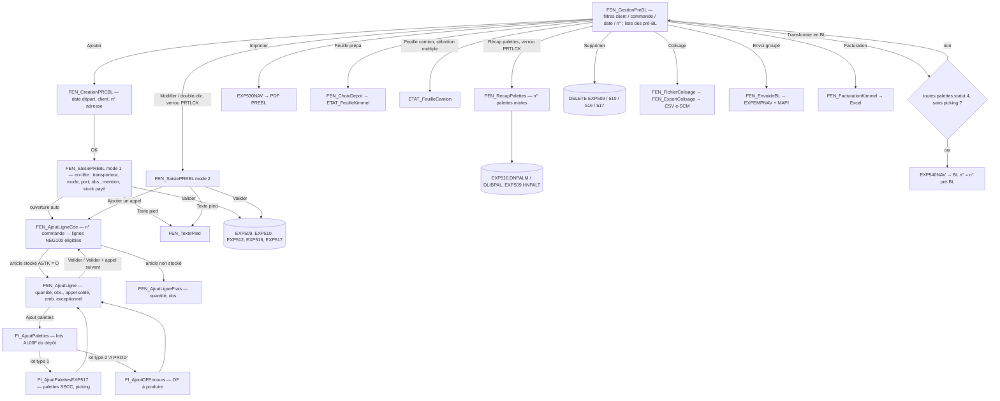

# PreBL — Gestion des pré-BL avec choix des palettes code-barre (SSCC)

> *Source :* projet WinDev `D:\Mes Projets\PreBL` (`PreBL.wdp`, exécutable `PreBL.exe` du 11/06/2026, WinDev 31)
> *Fenêtres principales :* `FEN_GestionPreBL`, `FEN_CreationPREBL`, `FEN_SaisiePREBL`, `FEN_AjoutLigneCde`, `FEN_AjoutLigne`, `FEN_AjoutLigneFrais`, fenêtres internes `FI_AjoutPalettes`, `FI_AjoutPalettesEXP517`, `FI_AjoutOFEncours`, `FEN_RecapPalettes`
> *Fenêtres annexes :* `FEN_ChoixDepot`, `FEN_TextePied`, `FEN_FichierColisage` / `FEN_ExportColisage`, `FEN_EnvoideBL` / `FEN_Adrmail`, `FEN_FacturationKimmel`, `FEN_ValeursParDefaut`
> *Classes :* `CEXP510` (élément), `CEXP516` (ligne de lot), `CEXP517` (palette), `CEXP512` ; `CL_Mapi32` (envoi de courriel)
> *États :* `ETAT_FeuilleCamion`, `ETAT_FeuilleKimmel`, `ETAT_FeuilleKimmel3`
> *Procédures globales :* collection externe partagée `COL_ProcéduresGlobales` (société `CodeSoc`, compte général par défaut `CpteGen`, profil `gsProfil`, bibliothèque programmes `BibPgm`, `Process_Connexion`) — **non fournie dans le projet**. Aucune collection `.wdg` propre ; variables globales déclarées dans le code du projet (`PreBL.wdp`).
> *Date d'analyse :* 2026-11-01 — *Auteur d'origine :* DL (tables EXP509… sept. 2022, EXP540 janv. 2023)
> *Variante :* projet `D:\Mes Projets\PreBLSansPalette` (même code à ~90 %), voir § « Variante sans palette »

## Synopsis & objectif

PreBL prépare les **expéditions de produits finis stockés sur palettes code-barre (SSCC, table `PROD_ENTITE`)** avant la création du vrai bon de livraison. L'opérateur crée un **pré-BL** pour un client et une adresse de livraison, y ajoute des **appels de livraison** (lignes de commande négoce `NEG100`), et pour chaque appel choisit **le lot, le dépôt et les palettes précises** (SSCC) à expédier, avec éventuellement une **quantité de picking** (palette entamée).

Ensuite :
1. le **récapitulatif palettes** numérote les palettes du chargement (palettes complètes puis palettes mixtes) ;
2. la **feuille de préparation** (« feuille Kimmel », du nom du prestataire logistique) et la **feuille camion** sont imprimées ;
3. les préparateurs **pointent les palettes** avec les terminaux (web services PHP GRA/CFP : statut `PROD_ENTITE` 3 puis 4) ;
4. quand toutes les palettes sont pointées (statut 4) et sans picking restant, le pré-BL est **transformé en BL** par le programme RPG **EXP540** (via `EXP540NAV`), qui crée EXP009/010/012/015/016, sort le stock, passe les palettes au statut 5 et marque le pré-BL livré (`HENBL = 'O'`).

Le numéro de pré-BL est pris **dans le compteur des BL** (fonction SQL `GETBL`) : le BL créé par EXP540 porte **le même numéro** que le pré-BL.

Fonctions annexes : envoi des BL par courriel, fichier de colisage Hermès (e-SCM), export Excel de facturation du stockage Kimmel.

## Contexte d'appel

| Appelant | Situation | Paramètres |
| --- | --- | --- |
| Menu NetPrint (MenuNetprint) *(supposé)* | Lancement de `PreBL.exe` | Société, profil et connexion via `COL_ProcéduresGlobales.Process_Connexion` |
| `FEN_GestionPreBL` | Liste des pré-BL, point d'entrée unique | — |

Paramétrage **par poste** dans `PreBL.Ini` (répertoire de l'exécutable, fenêtre `FEN_ValeursParDefaut`) :

| Clé `[PARAM]` | Rôle |
| --- | --- |
| `CptGen`, `CptAux`, `Depot` | Client et dépôt par défaut du fichier de colisage |
| `Chemin` | Répertoire de dépôt des fichiers de colisage |
| `FeuilleCamionValorisee` | Feuille camion valorisée (0/1) |
| `ImprimerCodeBarreUiteFeuillePrepa` | Code-barre unité sur la feuille de préparation |
| `CalcPalExpDepConf` | Mode de calcul « palettes / poids par dépôt confié » : change le calcul du poids théorique, la feuille de préparation (choix du dépôt ou non) et le contrôle de dépôt des palettes mixtes |
| `PoidsPalette` | Poids d'une palette vide, transmis à EXP530 et EXP540 |
| `[GENERAL] Depot1..5` | Dépôts de la facturation Kimmel |

`NetPrint.Ini` `[GUISys TN5250] Host` : nom de l'IBM i pour ouvrir les PDF (`\\hôte\home\pdf\temp\…`, `\\hôte\home\bl_PDF\…`).

## Écrans et parcours

### Détail par écran

**FEN_GestionPreBL — liste** : filtres compte général/auxiliaire (F4), commande + clé (F4), date de départ, n° de pré-BL, « avec livrés ». Colonnes : n°, client, nom, date prévue, n° adresse, raison sociale, CP, ville, transporteur, statut (`HENBL` : `O` « Livré », `E` « En cours », blanc), profil, date de création, « Stock payé ». Boutons/menu : Ajouter, Modifier, Supprimer, Imprimer, Récap palettes, Feuille Kimmel, Feuille camion, Transformer en BL, Colisage, Envoi groupé, Facturation, Paramétrage, Valeurs par défaut. Chargement uniquement sur le bouton (rien à l'ouverture).

**FEN_CreationPREBL** : date de départ (défaut : aujourd'hui), client (gén. par défaut `CpteGen`, aux.), n° d'adresse de livraison (F4 `FEN_RecNAdrLiv`), « stock payé ». Récupère les commentaires d'adresse `A500F.ALCOMM/ALCOM2/ALCOM3` comme observations par défaut.

**FEN_SaisiePREBL** : n° (affiché), date de départ, transporteur (F4), mode de transport (`HTYPL` : Express E, Messagerie M, Affrètement A, International I, Multi-pal P ; défaut `EXP005.FETYPL`), type de port (`HTYPP` : Avancé A, Dû D, Enlèvement E, Franco F ; défaut `EXP005.FEPORT`), n° adresse, 3 observations, mention BL/facture, poids total (saisi) et poids théorique (calculé), stock payé, mot directeur client. Table des appels : article + indice, réf. imprimée, commande, désignation, réf. client, n° d'appel, quantité, observation, nb palettes, nb colis, type de colis, incomplets, montant (lignes de frais), sous-table par dépôt (palettes / colis / ex. / « Incomplète »).

**FEN_AjoutLigneCde** : saisie d'un n° de commande (F4 `FEN_RecDossiers` filtré sur le client) ; liste des lignes `NEG100` restant à livrer (article, réf. imprimée, reste `DNQTEC - DNQTEL`, date de livraison, n° d'appel, adresse, client facturé).

**FEN_AjoutLigne** : rappel commande / article / réf. imprimée / n° d'appel / date / reste à livrer ; conditionnement (caisse `AMATUC`, emballage par `AEMBP`, UC par palette `ANPAL`, en bleu gras si conditionnement exceptionnel client `SPF026`), observation palette `APALOBS` ; saisie quantité, 3 observations, appel soldé, état de livraison (`DETALI` : Acompte A, Totalité T, Solde S ; défaut T), emballage par exceptionnel + UC/palette exceptionnel (modifiables tant qu'aucun lot n'est saisi). Table des lots (lot, dépôt, quantité, palettes, n° palette mixte, colis, conditionnement, emb. par, incomplète, ex. incomplets ; lignes « A PROD » en rouge).

**FI_AjoutPalettes** : lots disponibles de l'article (`AL00F`) : lot, dépôt, quantité en stock, nombre de SSCC, déjà réservé.

**FI_AjoutPalettesEXP517** : palettes SSCC du lot/dépôt : case à cocher, n° SSCC, quantité disponible, colis, date de fabrication, conditionnement final, palette groupée, quantité de picking, observation, statut, emplacement ; « Tout cocher » ; totaux palettes / colis / ex. incomplets / quantité, case « palette incomplète » ; boutons Valider et Valider + lot suivant.

**FEN_RecapPalettes** : par ligne de lot (dépôt, article, réf. imprimée, désignation, commande, lot, quantité, emb. par, caisse, colis, colis incomplets, ex. incomplets, ex. par palette, palettes, ex. hors palettes complètes, colis de picking) : saisie du **n° de palette mixte** pour les lignes « incomplètes » ; Calculer puis Valider.

## Règles métier

**Création et en-tête**

- **R1.** Un pré-BL concerne **un seul client donneur d'ordre et une seule adresse de livraison** (`HGENE/HCLIE`, `HNADRE`) ; client existant non annulé (`AA0003.CTAG <> '*'`), adresse existante (`A500F.ALTAG <> '*'`) (`FEN_CreationPREBL.Controle`, `FEN_AjoutLigneCde.Col_ClientFacture`).
- **R2.** Le numéro est obtenu par la fonction SQL **`GETBL(soc, enseigne, type)`** : type `P` à l'ouverture pour l'affichage, type `D` à la validation pour l'attribution (`FEN_SaisiePREBL.GetBL`). C'est le **compteur des BL** : EXP540 crée le BL avec `DNBL = HNOBL` *(numéro « P » = aperçu sans consommation, supposé)*. Voir A4.
- **R3.** Le texte de pied est initialisé à la création depuis les textes BL du client (`CLITXB`), modifiable dans `FEN_TextePied` (999 lignes max, lignes vides de fin supprimées), réécrit en `EXP512` à chaque validation.
- **R4.** « **Stock payé** » (`HSTOCKP` O/N) : le pré-BL ne puise que dans les **dépôts facturés** (`B100F.DFACTUR = 'O'`) ; sinon uniquement dans les dépôts `DFACTUR = 'N'`. En stock payé, les lignes de commande dont l'article a `SPF010.AOPT7 = 'O'` sont exclues *(supposé : articles de frais facturés à part)*.
- **R5.** Les droits sont lus dans `PRT000P1` sous le **code programme `OPR100`** (groupe `AI00F.AGROUP` puis profil) : `AOPT01` total, `02` création, `03` modification, `04` suppression ; `**` = interdit (bouton grisé ou fermeture « Vous n'êtes pas autorisé à la gestion des OPR »). Le profil prime sur le groupe.

**Appels de livraison (lignes)**

- **R6.** Le dossier saisi doit être une **commande** (`AB001.CCTYPC` = `3` ou `4`).
- **R7.** Lignes proposées : `NEG100.DNSTAT = '1'`, `DNSOLD <> 'O'`, client du dossier = client du pré-BL, `DNLIGA` = adresse du pré-BL ; pour un article **stocké** (`ASTK = 'O'`), la ligne ne doit pas déjà figurer dans un **pré-BL non livré** (`EXP509.HENBL <> 'O'`) ; tri par date de livraison puis n° de ligne. Quantité proposée = reste à livrer `DNQTEC - DNQTEL`.
- **R8.** Une même ligne de commande ne peut figurer qu'une fois dans le pré-BL (« Cette ligne est déjà dans le PREBL. »).
- **R9.** Tous les appels d'un pré-BL doivent avoir le **même client facturé** (`NEG100.DNGENF/DNCLIF`, à défaut `AB001.CGENF/CCLIF`) ; un appel sans client facturé est accepté (« Le client facturé est différent de celui du PREBL. »).
- **R10.** Article stocké → `FEN_AjoutLigne` (choix des lots/palettes) ; article non stocké → `FEN_AjoutLigneFrais` (quantité seule, montant = `DNPUS` si `TNUM` = 0 ou 999 999 999 « Le tout », sinon `quantité × DNPUS / TNUM`).
- **R11.** Conditionnement : emballage par = `SPF026` (conditionnement exceptionnel du client / adresse) sinon `SPF010` ; idem UC par palette, caisse, poids. Un **emballage exceptionnel** saisi (`DEEMBPE`) impose l'UC/palette exceptionnelle (`DENPALE`) et réciproquement ; non modifiable dès qu'un lot est saisi.
- **R12.** La **quantité de l'appel doit être égale à la somme des quantités des lots** (`FEN_AjoutLigne.Controle`) ; quantité non nulle. *Aucun contrôle par rapport au reste à livrer de la commande.*

**Lots et palettes**

- **R13.** Lots proposés (`FI_AjoutPalettes`) : stock par lot `AL00F` de l'article/indice avec `PLQENT > 0`, dans les dépôts autorisés (R4) ; nombre de SSCC disponibles (`PROD_ENTITE` statut 1 ou 2, `NUMERO_OPR = 0`) et quantité déjà prise par d'autres pré-BL (`EXP517`). Un lot déjà présent dans l'appel n'est pas reproposé (modification par la ligne). « Plus de palette disponible » si quantité − déjà réservé ≤ 0.
- **R14.** Palettes proposées (`FI_AjoutPalettesEXP517`) : `PROD_ENTITE` de l'article, dépôt, OF/clé du lot (`NUMERO_OF` = 5 premiers car., `CLE_OF` = 6ᵉ), statut **1, 2, 3 ou 4**, hors OPR (`NUMERO_OPR = 0`) ; quantité disponible = `QUANTITE_EX` − quantités prises dans les **autres pré-BL** (`EXP517`) − quantités prises dans les **autres appels du pré-BL en cours** (mémoire). Palettes en statut **3 ou 4** (en préparation / conditionnées) : grisées, non sélectionnables.
- **R15.** Une palette cochée est prise **en entier** (`DPPICK = 'N'`, `DPQTEP` = disponible) ou **en picking** si une quantité de picking est saisie (`DPPICK = 'O'`, `DPQTEP` = picking).
- **R16.** Calculs : colis = partie entière(quantité / emballage par) ; ex. incomplets = reste ; **palette complète** si quantité = UC/palette × emballage par (valeurs exceptionnelles si saisies) ; « palette incomplète » cochée si une palette n'a pas la quantité standard. Les ex. incomplets ≥ emballage par sont reconvertis en colis. Somme des palettes cochées = quantité saisie (« Les quantités doivent être égales. ») ; au moins une palette (« Au moins une palette doit être sélectionnée. »).
- **R17.** Ligne **type 2 « A PROD »** (`DNTYPL = '2'`, dépôt 0) : OF non encore produit, saisi en nombre de colis/palettes/ex. incomplets et type de colis (`FI_AjoutOFEncours`). La requête qui proposait ces OF (`AB0020`) est **commentée** : on ne peut plus que modifier des lignes type 2 existantes.
- **R18.** Une ligne de lot dont une palette est en statut 3 ou 4 ne peut pas être supprimée (bouton grisé).

**Totaux et poids**

- **R19.** Par appel : `DENPAL` = Σ palettes complètes, `DENUC` = Σ colis, `DEEXMEC` = Σ ex. incomplets ; sous-table regroupée par dépôt.
- **R20.** **Poids théorique** (affiché, non enregistré) : si `CalcPalExpDepConf` → Σ (`APDSU` × colis) ; sinon Σ (`APDSEX`/1000 × quantité + colis). Le **poids total** saisi est enregistré dans `HPDSTT` ; EXP540 le recalcule au passage en BL.

**Récapitulatif palettes (`FEN_RecapPalettes.Calcul`)**

- **R21.** Les palettes complètes sont numérotées séquentiellement ligne par ligne (« N° 1 à 3 ») ; les lignes « palette incomplète » doivent recevoir un **n° de palette mixte** (« Le n° de palette mixte doit être renseigné. »), qui reçoit un numéro après les palettes complètes (« N° 4 et n° 7 »).
- **R22.** Au plus **8 lignes** par palette mixte ; si `CalcPalExpDepConf = 0`, une palette mixte ne regroupe que des lignes d'un **même dépôt**.
- **R23.** Le nombre total de palettes est écrit dans `EXP509.HNPALT` ; le libellé des numéros dans `EXP516.DLIBPAL`.

**Édition, transformation, suppression**

- **R24.** Impression : si une ligne de lot n'a pas de `DLIBPAL` (récap non fait), avertissement « Impression impossible, veuillez faire le récapitulatif palettes avant » avec possibilité de passer outre ; puis appel **`EXP530NAV`** et ouverture de `\\hôte\home\pdf\temp\PREBLssssnnnnnn.pdf`.
- **R25.** **Transformation en BL** autorisée seulement si **toutes les palettes `EXP517` sont au statut 4** (pointées en préparation) et **aucune n'est en picking** (`DPPICK = 'O'`) ; sinon « Transformation impossible, toutes les palettes n'ont pas été pointées ou certaines palettes restent en picking. ». Appel **`EXP540NAV`** (société, n° pré-BL, poids palette) ; message « BL nnnnnn créé. ». Récap palettes et transformation grisés pour un pré-BL livré.
- **R26.** **Suppression** refusée si une palette du pré-BL est au statut 3 ou 4 (« Suppression impossible : certaines palettes sont en prepa. »), après confirmation.
- **R27.** Modification refusée si le pré-BL est livré (`HENBL = 'O'`, « Modification Impossible : Le PREBL est livré. ») ou verrouillé par un autre profil (« Le PREBL est en cours de modification par … »).

**Feuilles et exports**

- **R28.** **Feuille camion** : plusieurs pré-BL sélectionnés doivent avoir **même client, même date prévue, même transporteur et même adresse** ; `ETAT_FeuilleCamion` (valorisée selon `FeuilleCamionValorisee`, 4 dépôts au plus).
- **R29.** **Feuille de préparation** : si `CalcPalExpDepConf = 0`, choix d'un dépôt (`FEN_ChoixDepot`) puis `ETAT_FeuilleKimmel` filtré sur ce dépôt ; sinon tous dépôts.
- **R30.** **Fichier de colisage** (client Hermès, format e-SCM) : pré-BL d'un client à une date, un fichier `PKL_injection_<n°>-<RS>-<horodatage>.csv` par pré-BL dans `Chemin` ; une ligne par appel d'article stocké (référence `ARFIMP + " 00"`, quantité `DQTE`, n° de commande client `CCREFC` sans préfixe « 16. »), code fournisseur = `AA0003.CREFFO`.
- **R31.** **Envoi groupé** : pré-BL non livrés d'un client sur une période ; génération des PDF par **`EXPEMPNAV`** (BL, copie client si `PRT054F.CFEDIT = 'O'`, packing list si `CDRES2 <> 'N'`) dans `\\hôte\home\bl_PDF\<mot directeur>\` ; destinataires `PRT051F` (`CNBL` / `CNBLD`), choix dans `FEN_Adrmail` s'il y en a plusieurs ; envoi MAPI (Outlook) d'un courriel « PREBL du client … ».
- **R32.** **Facturation Kimmel** : export Excel mensuel pour 5 dépôts au plus : entrées / sorties par jour (`A900F`, emplacements `DESTOCK`, `PREPA`, `EXPE` et emplacements `STO050.ESOPT2 = 'O'`), palettes en stock (`EXP530` / `EXP531` : `CPPALNM`, `CPPALMO`, `CPPALHN` nid d'abeille), réceptions par type de stock (`A700F`, `AG00F`, `AN00F`).

## Contrôles & validations par écran

### FEN_CreationPREBL / FEN_SaisiePREBL

| Champ | Contrôle | Message | Règle |
| --- | --- | --- | --- |
| Date de départ | Date valide (sinon remplacée par aujourd'hui en sortie de champ) | « La date de départ doit être renseignée. » | — |
| Compte auxiliaire | Obligatoire, existe (`AA0003`, `CTAG <> '*'`) | « Le compte auxiliaire doit être renseigné. », « Le client n'existe pas. » | R1 |
| N° adresse | Obligatoire, existe (`A500F`, `ALTAG <> '*'`) | « Le n° d'adresse doit être renseigné. », « Le n° d'adresse n'existe pas. » | R1 |
| Transporteur | Obligatoire, existe (`B200F`, `MTAG <> '*'`) | « Le transporteur doit être renseigné. », « Le transporteur n'existe pas. » | — |
| Mode de transport, type de port | Obligatoires | « Le mode de transport doit être renseigné. », « Le type de port doit être renseigné. » | — |
| Table des appels | Au moins un appel | « Au moins un appel doit être saisi. » | — |

### FEN_AjoutLigneCde

| Champ | Contrôle | Message | Règle |
| --- | --- | --- | --- |
| N° commande | Obligatoire ; existe ; type 3 ou 4 | « Le n° de commande doit être renseigné. », « La commande n'existe pas. », « Le n° de dossier doit être une commande. » | R6 |
| Ligne choisie | Même client, même adresse, pas déjà présente, même client facturé | « Le client doit être identique. », « L'adresse doit être identique. », « Cette ligne est déjà dans le PREBL. », « Le client facturé est différent de celui du PREBL. » | R1, R8, R9 |
| Annuler sur un pré-BL vide en création | Confirmation | « Voulez-vous annuler la création du PREBL ? » | — |

### FEN_AjoutLigne / FEN_AjoutLigneFrais

| Champ | Contrôle | Message | Règle |
| --- | --- | --- | --- |
| Quantité | Non nulle ; = Σ lots | « La quantité doit être renseignée. », « La somme des quantités doit être égale à la quantité saisie. » | R12 |
| Emballage / UC palette exceptionnels | L'un impose l'autre | « Le nombre d'UC par palette exceptionnel doit être renseigné. », « L'emballage par exceptionnel doit être renseigné. » | R11 |
| (plusieurs lignes à colis incomplets) | **désactivé** (commenté) | « Plusieurs lignes comportent des colis incomplets. » | — |

### FI_AjoutPalettes / FI_AjoutPalettesEXP517

| Champ | Contrôle | Message | Règle |
| --- | --- | --- | --- |
| Lot | Disponible | « Plus de palette disponible. » | R13 |
| Palettes | Au moins une ; Σ = quantité | « Au moins une palette doit être sélectionnée. », « Les quantités doivent être égales. » | R16 |
| Palette non conforme au conditionnement | **désactivé** (commenté) | « Palette … non conforme au conditionnement. » | — |

### FEN_RecapPalettes

| Champ | Contrôle | Message | Règle |
| --- | --- | --- | --- |
| N° palette mixte | Obligatoire si palette incomplète ; même dépôt (si `CalcPalExpDepConf = 0`) ; ≤ 8 lignes | « Le n° de palette mixte doit être renseigné. », « Le regroupement de palettes doit être fait sur le même dépôt. », « Vous avez dépassé la limite de 8 pour une palette mixte. » | R21, R22 |

### FEN_GestionPreBL

| Action | Contrôle | Message | Règle |
| --- | --- | --- | --- |
| Modifier / Récap | Droits ; non livré ; verrou `PRTLCK` | « Vous ne pouvez pas modifier les PREBL. », « Modification Impossible : Le PREBL est livré. », « Le PREBL est en cours de modification par … » | R5, R27 |
| Supprimer | Aucune palette statut 3/4 ; confirmation | « Suppression impossible : certaines palettes sont en prepa. », « Confirmez-vous la suppression du PREBL n° … ? » | R26 |
| Imprimer | Récap fait (contournable) | « Impression impossible, veuillez faire le récapitulatif palettes avant. » | R24 |
| Transformer en BL | Palettes statut 4, sans picking | « Transformation impossible, … » | R25 |
| Feuille camion | ≥ 1 pré-BL ; même client / date / transporteur / adresse | « Au moins un PREBL doit être sélectionné. », « Le client, la date prévue, le transporteur et le n° d'adresse de livraison doivent être identiques. » | R28 |
| Colisage | Client, date, dépôt, répertoire | « Le client doit être renseigné. », « Le dépôt doit être renseigné. », « Le répertoire de destination doit être renseigné dans les valeurs par défaut. » | R30 |
| Envoi groupé | Dates, client, nom réduit société | « La date de début est supérieure à la date de fin. », « Le client doit être renseigné. », « Le nom réduit de la société doit être renseigné. » | R31 |

## Tables mises à jour

Toutes les écritures sont faites par SQL dynamique concaténé, **sans transaction**.

| Table | Opération | Où | Colonnes |
| --- | --- | --- | --- |
| **EXP509** en-tête pré-BL | INSERT | `FEN_SaisiePREBL.BTN_Valider` (création) | `RSOC, HNOBL` (GETBL `D`), `HDEXAA/MM/JJ`, `HOBS, HOBS2, HOBS3`, `HGENE, HCLIE`, `HNCOLT = 0`, `HNPALT = 0`, `HPDSTT` (poids saisi), `HTRAN`, `HTYPL`, `HTYPP`, `HNBEPL = 0`, `HENS = ''`, `HBART = 0`, `HPROF` (profil), `HNADRE`, `HMENTI`, `HENBL = ''`, `HDCREA` (date du jour AAAAMMJJ), `HSTOCKP` O/N |
| EXP509 | UPDATE | `FEN_SaisiePREBL.BTN_Valider` (modification) | mêmes colonnes sauf `HNOBL, HPROF, HDCREA` ; **remet `HNCOLT = 0`, `HNPALT = 0`, `HENBL = ''`, `HENS = ''`, `HBART = 0`** |
| EXP509 | UPDATE | `FEN_RecapPalettes.BTN_Valider` | `HNPALT` = nombre total de palettes |
| EXP509 | DELETE | `FEN_GestionPreBL.BTN_SupprimerPREBL` | `RSOC, HNOBL` |
| **EXP510** éléments (appels) | INSERT | `BTN_Valider`, action `A` | `RSOC, HNOBL, HNUM, HNODOS, HCLEF, HNUMLC, DART, DIND, DQTE, DOBS1-3, DAPPSOLD, DETALI, DENPAL, DENUC, DEEXMEC, DEEMBPE, DTYEMB, DEMBP1, DENPALE` |
| EXP510 | UPDATE | `BTN_Valider`, action `M` (**toutes les lignes chargées**) | `DQTE, DOBS1-3, DAPPSOLD, DETALI, DENPAL, DENUC, DEEXMEC, DEEMBPE, DTYEMB, DEMBP1, DENPALE` |
| EXP510 | DELETE | `BTN_Valider`, action `S` ; suppression du pré-BL | par `HNOBL, HNUM` ; par `HNOBL` |
| **EXP512** texte de pied | DELETE puis INSERT | `BTN_Valider` | `RSOC, HNOBL, HTNLIG, HTTXT` |
| **EXP516** lignes de lot | DELETE puis INSERT (chaque élément non supprimé) | `BTN_Valider` → `AjoutEXP516` | `RSOC, DNBL, DNUM, DNLIG` (renuméroté 1..n), `DNLOT, DNDEP, DNQTPL, DNPAL, DNPALM, DNUC, DEXMEC, DCOLIM, DPALINCOM, DNTYPL` ; **`DLIBPAL`, `DDOBS1/2`, `DCLOTU` non écrits** (remis à blanc) |
| EXP516 | UPDATE | `FEN_RecapPalettes.BTN_Valider` | `DNPALM` (n° palette mixte), `DLIBPAL` (libellé « N° 1 à 3 et n° 7 ») par `DNBL, DNUM, DNLIG` |
| EXP516 | DELETE | suppression du pré-BL | par `DNBL` |
| **EXP517** palettes du pré-BL | DELETE puis INSERT | `BTN_Valider` → `AjoutEXP517` | `RSOC, DNBL, DNUM, DNLIG, DPSSCC, DPQTEP, DPPICK, DPOBS` |
| EXP517 | DELETE | suppression du pré-BL | par `DNBL` |
| **PRTLCK** verrous | INSERT / DELETE | `FEN_GestionPreBL.DoubleClic`, `OPT_RecapPalette` / fermeture de `FEN_SaisiePREBL`, `FEN_RecapPalettes` | `PLFIC = 'PREBL'`, `PLCLE` = société (4) + n° (6), `PLPROF` = profil |

Non écrites par PreBL : **`PROD_ENTITE`** (la sélection d'une palette ne change pas son statut ; statuts 3/4 posés par les web services PHP de pointage, 5 par EXP540), `NEG100` (quantité livrée mise à jour par EXP540).

Fichiers hors base : `PreBL.Ini` (`INIEcrit` dans `FEN_ValeursParDefaut`, `FEN_FacturationKimmel`), CSV de colisage, classeur Excel.

## Tables consultées (lecture seule)

- **Paramètres** : `AA0007` (`SRS, SNOMC, SOP06, SOP03`), `DOS005` (`PARTFR, POPT08`), `STO005` (`PSDEPP, PSTSP1, PSEMP1-3`), `EXP005` (`FPDSP` poids palette, `FEPORT`, `FETYPL`, `FEFOND`), `AI00F` (groupe du profil), `PRT000P1` (droits `OPR100`).
- **Clients / adresses / transport** : `AA0003` (`CNOM, CMODIR, CREFFO, CTAG, CGENF…`), `A500F` (adresses `ALRS, ALRUE1/2, ALPOST, ALVILL, ALCOMM/2/3`), `CLITXB` (textes BL client), `B200F` (transporteurs), `B100F` (dépôts `DLIN/DLIB, DFACTUR`), `PRT051F` (courriels), `PRT054F` (`CFEDIT, CDRES2`).
- **Commandes / articles** : `AB001` (`CCDES1, CCTYPC, CCREFC, CCENSE, CGENF/CCLIF`), `NEG100` (`DNNLIG, DNART, DNIND, DNAPPE, DNQTEC, DNQTEL, DNDLIV, DNLIGA, DNSTAT, DNSOLD, DNPUS, DNUV, DNGENF/DNCLIF`), `AA00083` (unités de vente `TNUM`), `SPF010` / `SPF026` (conditionnement `AMATUC, AEMBP, ANPAL, ATYEMB, APDSU, APDSEX, APALOBS, ASTK, ARFIMP, ADES, AOPT7`), `C000F` (matières, `GLIBAB`).
- **Stock** : `AL00F` (stock par lot `PLREF, PLIND, PLLOT, PLDEP, PLQENT`), `PROD_ENTITE` (`NUMERO_SSCC, QUANTITE_EX, STATUT, DEPOT, NUMERO_OF, CLE_OF, NUMERO_OPR, PALETTE_GROUP, CDT_FINAL, DATE_HEURE_FABRICATION, DATE_ENT_STOCK, EMPLACEMENT`).
- **Facturation Kimmel** : `A900F`, `STO050`, `EXP530`, `EXP531`, `A700F`, `AG00F`, `AN00F`.

## Compteurs

- **N° de pré-BL = n° de BL** : fonction SQL `GETBL(soc, enseigne, 'P'|'D')` (bibliothèque programmes) lue dans `select getBL(...) from aa0007`. Pas de compteur propre aux pré-BL.
- `HNUM` (élément) : max + 1 en mémoire (`DernHNUM`) ; `DNLIG` (ligne de lot) : renuméroté 1..n à chaque validation.
- N° de palettes (récap) : calcul en mémoire, pas de compteur.

## Programmes IBM i appelés

Tous via `call QSYS2.QCMDEXC('call <BibPgm>/xxxNAV parm(''…'')')` (chaîne concaténée) :

| Programme | Appelant | Paramètre | Rôle |
| --- | --- | --- | --- |
| **EXP530NAV** → EXP530 | `BTN_Imprimer` | soc (4) + n° (6) + 16 blancs + poids palette (3) | Édition PDF du pré-BL dans `/home/pdf/temp/PREBL<soc><n°>.pdf` |
| **EXP540NAV** → **EXP540** | `OPT_TransformerBL` | soc (4) + n° (6) + poids palette (3) | Transformation en BL : écrit `EXP009` (même n°, `HETABL = 'C'`, `HTYPBL = '2'`), `EXP010`, `EXP012`, `EXP015`, `EXP016` (MERGE), mouvements `A700LC`, met à jour `NEG100` (quantité livrée, soldé), `AB001` (soldé `CCTAGS = 'D'`), `PROD_ENTITE` (statut 5, `NUMERO_BL`, `ELEMENT_BL`, `NUMERO_LIGNE_BL`, palette groupée vidée), `EXP509.HENBL = 'O'`, recalcule `HPDSTT` |
| **EXPEMPNAV** → EXPEMPNA1 / EXPEMPNA2 | `FEN_EnvoideBL.chargetable` | soc + n° + copie client O/N + packing list | Génération des PDF BL / CC / PL dans `/home/bl_PDF/` |
| Fonction SQL **GETBL** | `FEN_SaisiePREBL.GetBL` | soc, enseigne, `P`/`D` | Numéro |

Non appelés : `STOREVNAV` (absent des deux projets). Les web services PHP **GRA / CFP** (`articles_controllerGRA.php`, `articles_controllerCFP.php`) font le pointage terrain : `PROD_ENTITE.STATUT` 3 (destockage vers l'emplacement pré-BL) puis 4 (emplacement de préparation), `EXP509.HENBL = 'E'` (en cours), retour à blanc si plus aucune palette en préparation.

## Transactions et verrous

- **Aucune transaction** : la validation d'un pré-BL enchaîne 5 à plusieurs dizaines d'ordres indépendants (en-tête, pied, éléments, lots, palettes) ; une erreur SQL affiche un message mais **la boucle continue et la fenêtre se ferme** quand même.
- **Verrou applicatif `PRTLCK`** (`'PREBL'`, soc + n°) pris par lecture puis INSERT (non atomique) à l'ouverture en modification et au récap palettes ; libéré à la fermeture de `FEN_SaisiePREBL` / `FEN_RecapPalettes`. Non vérifié par : création, suppression, impression, transformation en BL, feuilles. Plantage du poste = verrou orphelin.
- **Pas de réservation des palettes** : la « réservation » d'un SSCC n'existe que par sa présence dans `EXP517` d'un autre pré-BL, relue à l'ouverture de la fenêtre ; deux saisies simultanées peuvent prendre la même palette.

## Anomalies relevées (à ne pas reproduire)

- **A1. Aucune transaction, erreurs ignorées** (voir ci-dessus) : pré-BL partiellement écrit possible (EXP510 sans EXP516, EXP516 effacé sans réinsertion…).
- **A2. SQL concaténé** partout (valeurs numériques et chaînes ; seules les apostrophes des observations sont doublées).
- **A3. Réécriture complète à chaque validation** : toute ligne chargée est en action `M` ; EXP516/EXP517 de **tous** les appels sont supprimés et réinsérés. Conséquences : `DLIBPAL` (récap palettes), `DDOBS1/2` et **`DCLOTU` (préparation clôturée)** sont remis à blanc, `HNPALT/HNCOLT` remis à 0 et **`HENBL` remis à blanc même si la préparation est « En cours »** (`E`).
- **A4. Numérotation** : le n° affiché (GETBL `P`) peut différer du n° enregistré (GETBL `D`) ; l'enseigne passée à `GETBL` est la variable globale `CCENSE`, vide à l'ouverture et égale à l'enseigne de la **dernière commande consultée** dans `FEN_AjoutLigneCde` à la validation. Le pré-BL consomme un n° de BL : un pré-BL supprimé laisse un **trou dans la numérotation des BL**.
- **A5. Suppression incomplète et trop permissive** : `EXP512` (pied) n'est pas supprimé ; un pré-BL **livré** peut être supprimé (ses palettes sont au statut 5, le contrôle 3/4 passe) ; pas de contrôle du verrou.
- **A6. Branche `AUTRE CAS`** de la boucle de validation : `MonSql` n'est pas réinitialisé, l'ordre précédent est réexécuté puis `AjoutEXP516` écrit sous le `HNUM` précédent *(rare : aucune ligne n'a d'action vide, supposé)*.
- **A7. Suppression d'un appel** : le bouton est grisé si des palettes sont en préparation, mais l'option de menu `OPT_SupprimerElement` ne l'est pas.
- **A8. Lignes de frais** (`FEN_AjoutLigneFrais`) : la ligne de commande est ajoutée **deux fois** à `tabCommande` ; en modification, `Detail.DAPPSOLD[IndPREBL]` lit un caractère de la chaîne au lieu de la valeur (« appel soldé » mal relu dès la 2ᵉ ligne).
- **A9. Pas de contrôle de quantité** par rapport au reste à livrer de la commande ; seul EXP540 solde la ligne.
- **A10. Transformation en BL** : un pré-BL **sans aucune palette `EXP517`** (frais seuls, ou lignes « A PROD ») passe le contrôle (la vérification « aucune palette » est commentée) ; le contrôle d'état n'est pas refait au moment de l'appel (double clic / deux postes → EXP540 rejoué, *supposé* d'après `logistique-analyse.md`).
- **A11. Droits sous le code `OPR100`** avec messages « gestion des OPR » : pas d'autorisation propre aux pré-BL.
- **A12. Paramètres de calcul par poste** (`PreBL.Ini`) : `CalcPalExpDepConf` et `PoidsPalette` changent le poids, la feuille de préparation et le contrôle des palettes mixtes **selon le PC**.
- **A13. Fichier de colisage** : le nombre total d'articles n'est calculé que pour le **premier** pré-BL exporté et jamais remis à zéro.
- **A14. Envoi groupé** : `FEN_EnvoideBL.InitVarglobale` **déconnecte** la connexion principale et se reconnecte avec `Parametre.Ini` (bibliothèque `NP11F` par défaut) ; envoi par MAPI (poste Outlook).
- **A15. Facturation Kimmel** : société `29` codée en dur dans une sous-requête ; Excel piloté par OLE.
- **A16. Capacités** : `HNPALT` sur 2 chiffres (99 palettes), `HTRAN` sur 2 chiffres ; `HTYPL` documenté « M/E » mais 5 valeurs utilisées.
- **A17. OF « A PROD »** : `FI_AjoutOFEncours` affecte `DNTYPL = '1'` puis `'2'` ; création de telles lignes impossible (requête commentée), code mort partiel.

## Variante sans palette (projet PreBLSansPalette)

**Contexte d'appel** : MenuNetprint lance `PreBL.exe` ou `PreBLSansPalette.exe` selon le paramètre société **`EXP005.FEPREB`** (« PREBL SANS PALETTE », CHAR 1) — sur NP11F de test : soc 8 = `O`, 29 = `N`, 31 = `N`, 55 = `O`. **Le code WinDev des deux projets ne lit pas `FEPREB`** (aucune occurrence dans les sources) : le choix est fait uniquement par le menu. Même fenêtres, mêmes tables, même code à ~90 % (comparaison du code extrait des `.wdw` / `.wdc` / `.wde`).

**Le principe** : au dernier écran, on **ne choisit pas les SSCC**. On déclare par lot / dépôt une **quantité** et des observations ; ce sont les préparateurs qui, en scannant (web service PHP **CFP**, `articles_controllerCFP.php`), créent les lignes `EXP517`, passent les palettes au statut 3 et le pré-BL à `HENBL = 'E'`.

| Point | PreBL | PreBLSansPalette |
| --- | --- | --- |
| Dernier écran `FI_AjoutPalettesEXP517` | Liste des SSCC `PROD_ENTITE` à cocher, picking, R14-R16 | **Pas de liste** : saisie de la quantité du lot et de 2 observations ; palettes complètes = quantité / (emb. par × UC/palette), colis = quantité / emb. par, « incomplète » si reste ; affiche la **quantité déjà préparée** (Σ `EXP517.DPQTEP` de la ligne) |
| Contrôles du dernier écran | ≥ 1 palette ; Σ palettes = quantité | Quantité non nulle ; **quantité ≥ déjà préparé** (« La quantité ne peut pas être inférieure à la quantité préparée. ») |
| « Déjà réservé » d'un lot (`FI_AjoutPalettes`) | Σ `EXP517.DPQTEP` des autres pré-BL (palettes statut 1/2) | Σ `EXP516.DNQTPL` des autres pré-BL **non livrés**, même article et `dind = ''` codé en dur |
| `EXP516` | INSERT sans `DDOBS1/2` | INSERT **avec `DDOBS1`, `DDOBS2`** (observations par lot, classe `CEXP516` étendue) ; toujours sans `DLIBPAL` ni `DCLOTU` |
| `EXP517` à la validation | DELETE + INSERT (palettes choisies) | **Ni DELETE ni INSERT** (code commenté) : les palettes scannées sont conservées |
| `EXP517` à la suppression du pré-BL | DELETE | **Non supprimé** (commenté) → palettes scannées orphelines (statut 2, voire 3 si le contrôle est contourné) |
| Suppression d'un appel | Bouton grisé si palettes 3/4 (au clic sur la ligne) | Idem, et grisé aussi au chargement du pré-BL |
| Plusieurs lignes à colis incomplets dans un appel | Contrôle désactivé | **Contrôle actif** : « Plusieurs lignes comportent des colis incomplets. » |
| Client facturé (R9) | Appel sans client facturé accepté | **Strict** : tout écart refusé |
| N° GETBL `P` | Pris avant le chargement des textes de pied | Pris après (même effet) |
| Feuille de préparation | `ETAT_FeuilleKimmel` (liste des palettes) | `ETAT_FeuilleKimmelDepot` (lots / quantités par dépôt, sans SSCC) |
| Feuille camion | 4 dépôts au plus | Pas de limite |
| Export colisage | Quantité `DQTE` | Lit **`DEQTE`, colonne inexistante dans `EXP510`** → requête en erreur *(supposé : export inutilisable)* |

**Transformation en BL** : code identique (`OPT_TransformerBL`) : toutes les palettes `EXP517` — ici celles **scannées** — doivent être au statut 4 sans picking, puis `EXP540NAV`. Conséquences propres à la variante :
- un pré-BL **sans aucun scan** n'a pas d'`EXP517` et passe le contrôle (A10) : EXP540 crée alors un BL sans sortie de palettes *(supposé)* ;
- aucun contrôle que la quantité scannée égale la quantité déclarée en `EXP516` ;
- comme `EXP516` est supprimé puis réinséré à chaque modification avec `DNLIG` renuméroté 1..n, les `EXP517` scannés peuvent **ne plus correspondre** à leur ligne (`DNUM/DNLIG`) si un lot a été retiré ou réordonné, et `DCLOTU` (préparation clôturée, utilisé par CFP) est remis à blanc (A3).

## Questions ouvertes

1. Sémantique exacte de `GETBL` type `P` / `D` et de l'enseigne : le n° de pré-BL doit-il rester celui du BL dans le SaaS ?
2. Signification de `SPF010.AOPT7` (exclu en stock payé, imprimé à part sur la feuille camion) : frais de stockage ?
3. Lignes « A PROD » (OF non produit) : fonction abandonnée ou à reprendre ?
4. Qui utilise encore `CalcPalExpDepConf = 1` (dépôt confié) et avec quel poids palette ? Paramètre société plutôt que poste ?
5. Le pointage GRA/CFP fait-il foi pour l'état « En cours » ? (la modification WinDev l'efface).
6. Fichier de colisage e-SCM et facturation Kimmel : encore utilisés (et pour quelles sociétés) ?
7. Pourquoi la liste « déjà réservé » des lots (`FI_AjoutPalettes`) ne compte-t-elle que les palettes statut 1/2 ?

## Notes pour la migration

- Un **pré-BL = une préparation d'expédition** rattachée à un client / une adresse ; dans le SaaS, en faire un objet « Préparation » qui **devient** le BL (même identifiant ou lien), avec écriture **transactionnelle** et réservation explicite des SSCC (statut ou table de réservation avec contrainte d'unicité).
- Remplacer la réécriture complète par des mises à jour différentielles qui **préservent** `DLIBPAL`, `DCLOTU`, `HENBL` et les pointages.
- Remplacer `PRTLCK` par un verrou optimiste (version de ligne).
- EXP530 / EXPEMPNAV / EXP540 : à reprendre nativement (PDF via le Socle Documents, transformation en BL dans le service Logistique), voir `docs/logistique-analyse.md` (L8).
